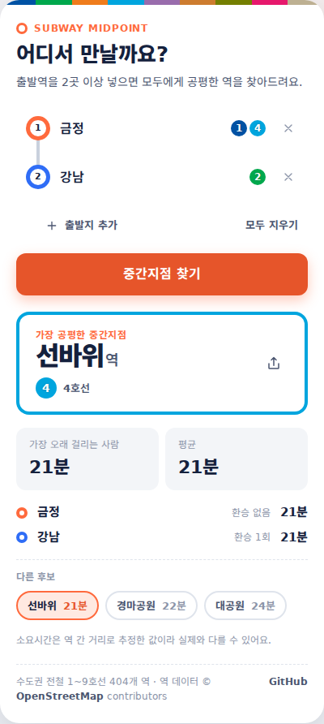
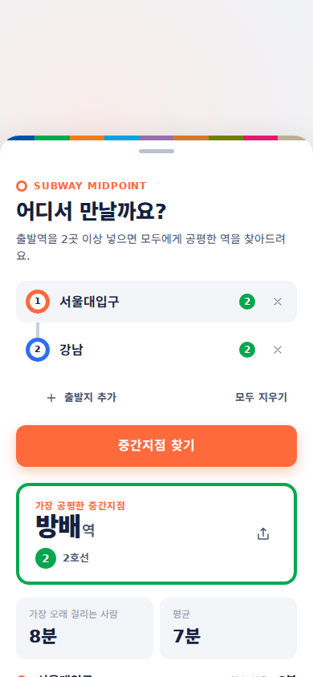
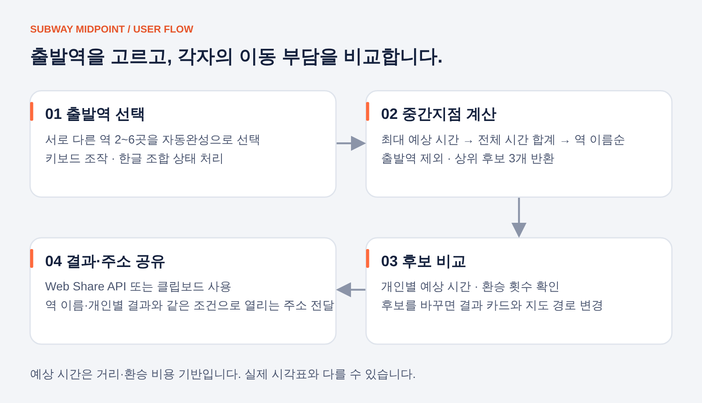
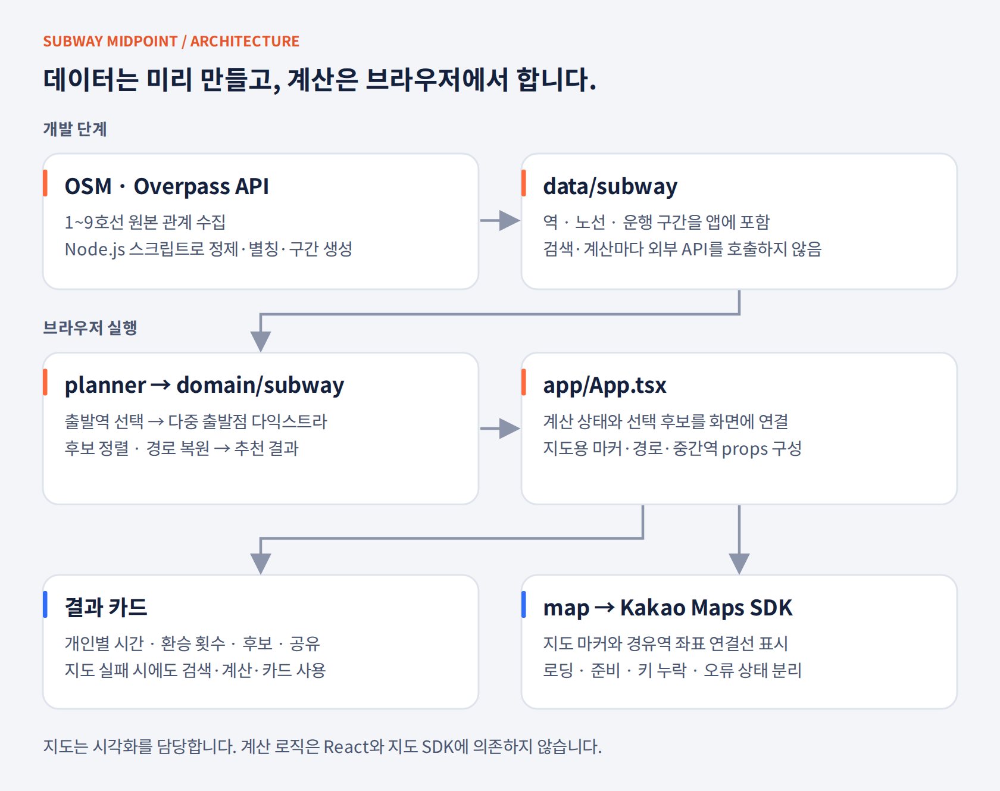

# Subway Midpoint · 어디서 만날까요?

**‘공평한 중간지점’을 계산 기준으로 정의하고, 추천 결과를 React 화면·지도·공유 주소까지 연결한 개인 프로젝트입니다.**

서로 다른 출발역 2~6곳을 선택하면 가장 오래 이동하는 사람의 예상 시간을 줄이는 역을 추천합니다. 상위 후보 3개의 개인별 시간·환승 횟수를 비교하고, 선택한 결과를 같은 조건으로 다시 열 수 있는 주소로 공유합니다.

[서비스 열기](https://minsangkwak.github.io/subway-midpoint/) · [개발 미리보기](https://minsangkwak.github.io/subway-midpoint/dev/) · [노션 포트폴리오](https://www.notion.so/3e7cbbdd109b81d59d04d5f472db58cb)

| 알고 싶은 내용 | 문서 |
|---|---|
| 설계 판단·변경 이력·구조·도메인 지도·트레이드오프·변경 영향·문제 추적 | [프로젝트 설명](docs/PROJECT.md) |
| 실행·계산 규칙·데이터 생성·화면 상태·지도 설정·배포·커밋 절차 | [개발 가이드](docs/DEVELOPMENT.md) |
| 테스트·측정 결과와 확인하지 않은 범위, 캡처 조건 | [검증 기록](docs/VALIDATION.md) |

## 핵심 구현과 설계

추천 기준, 역·환승 데이터, 계산, 화면 상태를 연결하고 키보드 접근성과 검증·배포를 함께 구성했습니다. 1인 프로젝트로 기획부터 배포까지 맡았습니다.

| 구현 영역 | 해결한 문제 | 관련 코드·문서 |
|---|---|---|
| 기획·계산 기준 | 지도 가운데가 아닌 최대 예상 이동시간을 기준으로 추천. 동점 처리와 출발역 제외 규칙 결정 | [추천 기준](#추천-기준) · [설계 판단](docs/PROJECT.md#변경-이력과-설계-판단) |
| 데이터 | OpenStreetMap 노선 관계 수집·정제, 분기 노선의 잘못된 연결과 신촌·양평 동명이역의 오결합 방지, 생성 데이터 회귀 테스트 | [생성 스크립트](scripts/fetch-stations.mjs) · [그래프](src/domain/subway/graph.ts) · [데이터 테스트](src/data/subway/stations.test.ts) |
| 계산과 성능 | 이진 힙 다익스트라, 점수로 후보를 먼저 정렬하고 상위 후보만 경로 복원 | [추천 알고리즘](src/domain/subway/midpoint.ts) · [측정 조건](docs/VALIDATION.md#성능-측정) |
| 프론트엔드 | React 19·TypeScript, reducer 기반 입력 상태(변경 시 결과 무효화), 공유 URL로 입력·후보 복원, Kakao Maps 연동 | [reducer](src/features/planner/model/plannerReducer.ts) · [URL 상태](src/features/planner/model/urlState.ts) · [map](src/features/map/) |
| UX/UI·접근성 | 안내 사인 모티프 토큰, CSS Modules, 모바일 하단 패널, ARIA combobox·tab 패턴, 한글 IME 처리, 지도 실패 시 계산 유지 | [토큰](src/app/styles/tokens.css) · [검색 입력](src/features/planner/ui/DepartureField.tsx) |
| 품질·운영 | Vitest 단위·회귀 테스트, Playwright 브라우저 테스트, GitHub Actions CI, 운영·개발 Pages 배포 | [CI](.github/workflows/ci.yml) · [e2e](e2e/) · [검증 기록](docs/VALIDATION.md) |

## 현재 구현 범위

| 항목 | 범위 |
| --- | --- |
| 데이터 | 수도권 전철 13개 노선·509역, 노선별 노드 606개·운행 구간 149개 |
| 노선 | 1~9호선·신분당선·경의중앙선·수인분당선·공항철도 |
| 입력·결과 | 서로 다른 출발역 2~6곳, 추천역을 포함한 상위 후보 3개 |
| 공유 | 출발역 키와 후보 인덱스를 URL에 저장하고 첫 로드에서 복원 |
| 검증 기록 | 2026-11-09 로컬 실행: Vitest 9개 파일·59개 통과. Playwright는 `e2e/` 파일 기준 12개(2026-10-27 CI 통과 기록) |
| 주요 기술 | React 19 · TypeScript · Vite 7 · CSS Modules · Kakao Maps · OSM · GitHub Actions |

검증 수치는 [기존 실행 기록과 CI 근거](docs/VALIDATION.md)에 연결했습니다. 시간은 거리와 환승 비용으로 계산한 추정값입니다.

## 실행 화면

판교(신분당선)·일산(경의중앙선)·잠실(2·8호선)에서 출발한 결과입니다. 지도 키를 설정한 로컬 빌드에서 캡처했으며, 지도 위 선은 각 출발지에서 추천역까지의 경유역을 이은 경로입니다.



<details>
<summary>모바일 화면 보기</summary>

모바일에서는 하단 패널을 접고 펼칠 수 있습니다. 서울대입구·강남에서 출발한 결과입니다.



</details>

## 사용 흐름



1. **역 선택:** 자동완성에서 출발역을 고릅니다. 필요하면 최대 6곳까지 추가합니다.
2. **계산:** 출발역을 제외한 후보 중 최대 예상 시간이 작은 역을 찾습니다.
3. **비교:** 추천역과 대안 두 곳의 개인별 시간·환승 횟수를 확인합니다. 후보를 바꾸면 지도 경로도 바뀝니다.
4. **공유:** 결과 텍스트와 함께 `?from=판교,일산,잠실&pick=1` 형태의 주소를 전달합니다. 받는 사람은 같은 조건과 선택 후보로 바로 엽니다.

## 추천 기준

후보 A의 예상 시간이 20분·40분이고 후보 B가 32분·32분이면 B를 먼저 추천합니다. 총합보다 **가장 오래 걸리는 사람의 부담**을 우선하기 때문입니다. 실제 역이 아닌 기준 설명용 예시입니다.

1. 출발지별 최단 예상 시간의 최댓값이 작은 역을 고릅니다.
2. 최댓값이 같으면 전체 시간 합계, 그다음 한국어 역 이름순으로 정렬합니다.
3. 출발역과 모든 출발지에서 도달할 수 없는 역은 후보에서 제외합니다.

다익스트라는 출발지마다 수행합니다. 환승역에서 출발할 때는 해당 역의 여러 노선 노드를 비용 0으로 시작합니다. 가중치와 데이터 생성 규칙은 [개발 가이드](docs/DEVELOPMENT.md#계산-기준), 입력부터 URL 반영까지의 순서는 [핵심 프로세스](docs/PROJECT.md#핵심-프로세스)에 있습니다.

## 왜 이 기술인가

트렌드가 아니라 문제에서 고른 선택입니다. 각 항목의 대안과 비용은 [설계 트레이드오프](docs/PROJECT.md#설계-트레이드오프)에 있습니다.

| 선택 | 이유 (한 줄) |
| --- | --- |
| 다익스트라 + 직접 구현한 이진 힙 | 간선 가중치가 거리·환승으로 제각각이라 BFS로는 시간 최소화가 안 되고, 다중 출발점·역 단위 도착 같은 규칙을 함수 하나에 두려고 라이브러리 대신 [직접 구현](src/domain/subway/dijkstra.ts)했습니다. [자세한 비교](docs/PROJECT.md#왜-다익스트라와-이진-힙인가) |
| 브라우저에서 계산 | 데이터가 정적이고 출발지 최대 6곳의 탐색이 ms 단위라 서버가 필요 없습니다. 대신 데이터 갱신은 재배포입니다. |
| `useReducer` 하나 | 상태가 출발지·결과·선택 후보·오류 네 가지뿐이라 전이 규칙을 순수 함수로 테스트하는 데 스토어 라이브러리가 필요 없었습니다. |
| CSS Modules + 토큰 | 런타임 의존성 없이 클래스 충돌만 막고, 색·간격 기준은 [tokens.css](src/app/styles/tokens.css) 한 곳에서 관리합니다. |
| 거리 기반 추정 시간 | 외부 API 없이 결정적으로 테스트할 수 있습니다. 실제 시각표와의 오차는 아래 "현재 한계"에 적었습니다. |
| ESLint import 경계 | planner가 map을 모르게 강제해 지도 없이 계산을 테스트합니다. 어기면 lint가 실패합니다. |

## 화면과 계산을 연결한 구조



역 데이터는 개발 단계에서 생성해 앱에 포함합니다. 검색·계산 때마다 외부 데이터 API를 호출하지 않으며, 추천은 브라우저에서 실행합니다. 계산 코드는 React와 지도 SDK에 의존하지 않고, `App`이 결과를 카드와 지도에 전달합니다. 지도 키가 없거나 SDK 로딩이 실패해도 출발역 검색과 결과 비교를 사용할 수 있습니다.

핵심 타입과 필드([도메인 지도](docs/PROJECT.md#도메인-지도)), 의존 관계와 폴더 역할([구조](docs/PROJECT.md#구조)), 노선 추가·환승 비용·정렬 규칙을 바꿀 때 어디까지 바뀌는지([변경 영향 범위](docs/PROJECT.md#변경-영향-범위)), 결과가 이상할 때 어디부터 보는지([문제 추적 순서](docs/PROJECT.md#문제-추적-순서))는 [프로젝트 설명](docs/PROJECT.md)에 코드 기준으로 적었습니다.

## 직접 실행하기

Node.js 22 이상에서 실행합니다.

```bash
npm ci
npm run dev
```

[로컬 앱](http://localhost:5173/)에서 지도 키 없이 검색·계산을 확인할 수 있습니다. 지도 설정은 [개발 가이드](docs/DEVELOPMENT.md#지도-설정)를 참고해 주세요.

```bash
npm run check
npx playwright install chromium
npm run test:e2e
```

`check`는 lint·타입·단위 테스트·문서 링크·빌드를 실행합니다. Playwright는 지도 키 없는 preview 빌드에서 검색·계산·공유·모바일 흐름을 확인합니다.

## 현재 한계

- 시간은 평균 속도 32km/h, 역 간 최소 1.5분, 환승 5분으로 추정합니다. 실제 시각표·열차 대기·역별 환승 동선은 반영하지 않습니다.
- 최대 시간 최소화가 모든 사람의 이동시간을 같게 만들지는 않습니다.
- 지도 경로는 경유역 좌표를 이은 선이며 실제 철도 선형과 다릅니다.
- 급행·직통과 13개 노선 밖의 광역·경전철은 범위 밖입니다. 공용 승강장 구간에도 노선 변경 시 환승 5분을 적용합니다.
- 운영 도메인의 지도 인증, 실기기 IME·스크린리더·공유 시트는 [자동 검사와 별도의 확인 항목](docs/VALIDATION.md#확인하지-않은-범위)입니다.

다음 단계는 [프로젝트 설명](docs/PROJECT.md#다음-단계)에 있습니다.

## 이용 조건

- 코드는 [MIT 라이선스](LICENSE)로 공개합니다.
- 역 데이터의 출처는 [OpenStreetMap contributors](https://www.openstreetmap.org/copyright)이며 [ODbL](https://opendatacommons.org/licenses/odbl/) 조건을 따릅니다. 앱 화면 하단에 출처를 표기합니다.
- 지도 타일과 SDK는 [Kakao Maps API](https://apis.map.kakao.com/) 이용 약관을 따릅니다. JavaScript 키는 허용 도메인으로 보호하며 저장소에 두지 않습니다.
- 노선 상징색은 각 운영사의 안내 체계를 참고한 값이며, 운영사와는 무관한 개인 프로젝트입니다.
