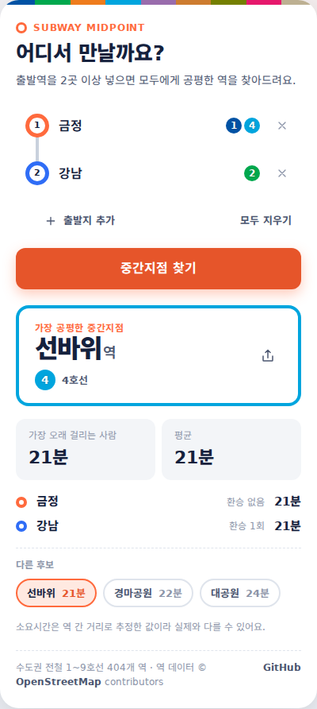
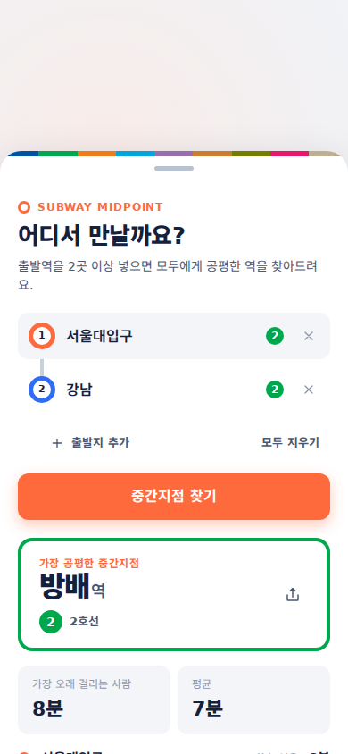
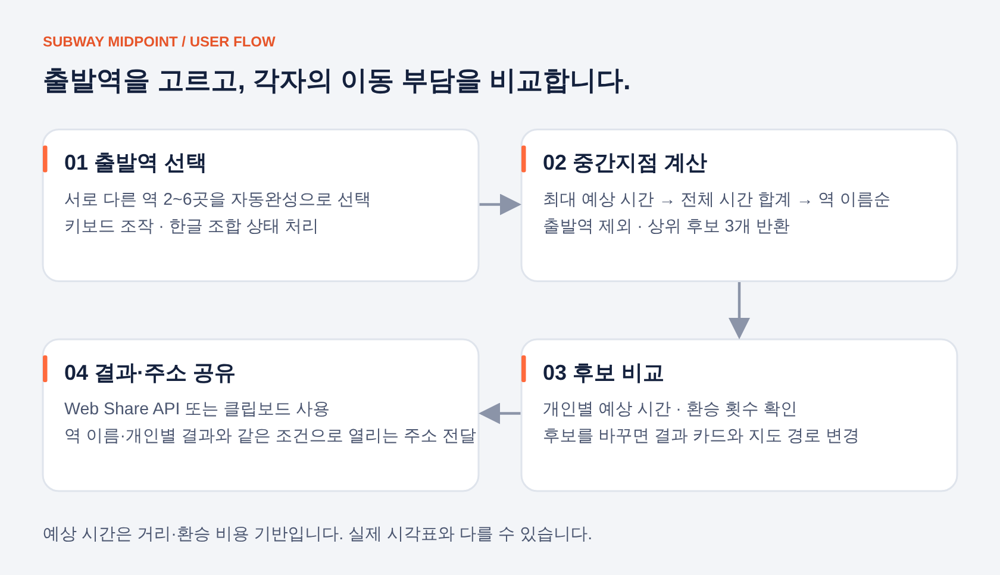
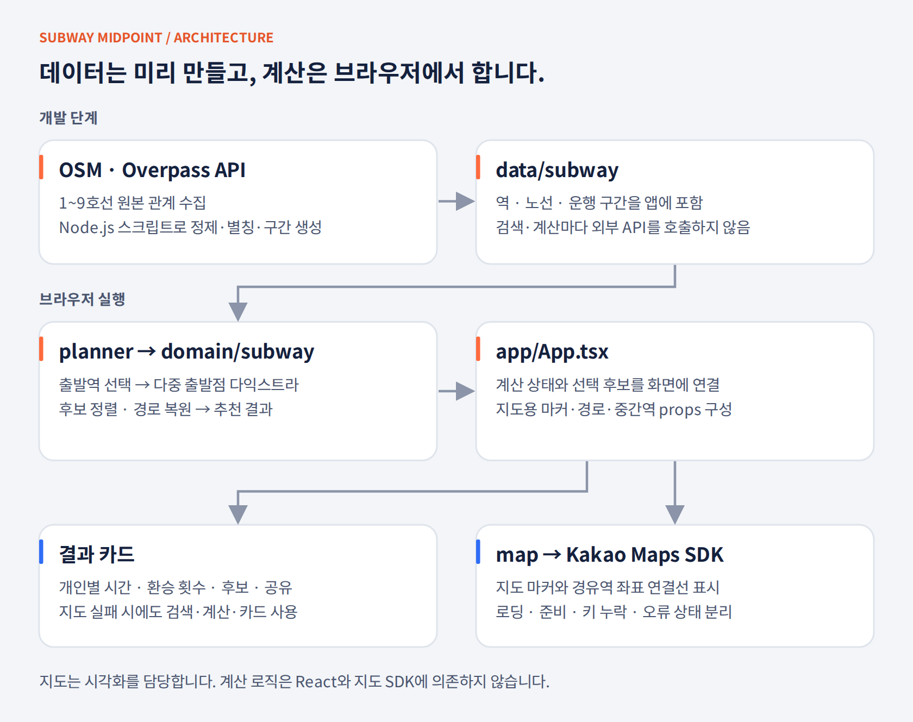

# Subway Midpoint · 어디서 만날까요?

**서로 다른 역에서 출발하는 사람들이 만날 때, 가장 오래 이동하는 사람의 예상 시간을 줄이는 중간역 추천 서비스입니다.**

출발역 2~6곳을 선택하면 추천역과 대안 두 곳을 비교할 수 있습니다. 각자의 예상 이동시간·환승 횟수를 보여주고, 선택한 후보의 경로를 지도에 표시하며, 같은 조건으로 다시 열리는 주소를 공유합니다.

[서비스 열기](https://minsangkwak.github.io/subway-midpoint/) · [개발 미리보기](https://minsangkwak.github.io/subway-midpoint/dev/) · [노션 포트폴리오](https://www.notion.so/3e7cbbdd109b81d59d04d5f472db58cb) · [문서 모음](docs/README.md)

> 살펴볼 핵심: 다중 출발점 다익스트라 · 최대 이동시간 최소화(minimax) · OSM 노선 데이터 정제 · URL 상태 복원 · 지도 실패 대응 · 단위·브라우저 테스트 CI

## 실행 화면

판교(신분당선)·일산(경의중앙선)·잠실(2·8호선)에서 출발한 결과입니다. 지도 키를 설정한 로컬 빌드에서 캡처했으며, 지도 위 선은 각 출발지에서 추천역까지의 경유역을 이은 경로입니다.



<details>
<summary>모바일 화면 보기</summary>

모바일에서는 하단 패널을 접고 펼칠 수 있습니다. 서울대입구·강남에서 출발한 결과입니다.



</details>

## 사용 흐름



1. **역 선택:** 자동완성에서 출발역을 고릅니다. 필요하면 최대 6곳까지 추가합니다.
2. **계산:** 출발역을 제외한 후보 중 최대 예상 시간이 작은 역을 찾습니다.
3. **비교:** 추천역과 대안 두 곳의 개인별 시간·환승 횟수를 확인합니다. 후보를 바꾸면 지도 경로도 바뀝니다.
4. **공유:** 결과 텍스트와 함께 `?from=판교,일산,잠실&pick=1` 형태의 주소를 전달합니다. 받는 사람은 같은 조건과 선택 후보로 바로 엽니다.

## 어떤 문제를 푸는가

지도의 가운데에 있는 역이 모두에게 편한 장소는 아닙니다. 분기와 환승 때문에 가까워 보이는 곳까지도 누군가는 오래 이동해야 합니다. 이 프로젝트는 **가장 오래 걸리는 사람의 예상 시간**을 우선 줄이고, 같은 조건이면 전체 시간 합계를 비교합니다.

| 입력 | 계산 | 결과 |
|---|---|---|
| 서로 다른 출발역 2~6곳 | 각 출발지의 최단 예상 시간 → 후보별 최댓값 비교 | 상위 3개 역·개인별 시간·환승 횟수·지도 경로·공유 주소 |

수도권 전철 **13개 노선 509개 역**(1~9호선, 신분당선, 경의중앙선, 수인분당선, 공항철도)을 대상으로 브라우저에서 계산합니다. 시간은 역 간 거리와 환승 비용으로 추정하며 실제 시각표와 다를 수 있습니다.

## 담당 역할

1인 프로젝트로 기획부터 배포까지 맡았습니다. 각 역할의 산출물은 아래 링크에서 확인할 수 있습니다.

| 역할 | 한 일 | 산출물 |
|---|---|---|
| 기획·계산 기준 | "공평함"을 최대 예상 시간 최소화로 정의, 동점 처리와 출발역 제외 규칙 결정 | [프로젝트 설명](docs/PROJECT.md) · [계산 기준](docs/DEVELOPMENT.md#계산-기준) |
| 데이터 | OpenStreetMap 노선 관계 수집·정제 스크립트, 이름만 같은 역 분리, 생성 데이터 회귀 테스트 | [생성 스크립트](scripts/fetch-stations.mjs) · [데이터 테스트](src/data/subway/stations.test.ts) |
| 프론트엔드 | React 19·TypeScript, reducer 기반 입력 상태, URL 상태 복원, Kakao Maps 연동 | [planner](src/features/planner/) · [map](src/features/map/) |
| UX/UI·접근성 | 안내 사인 모티프 토큰, CSS Modules, 모바일 하단 패널, ARIA combobox·tab 패턴, 한글 IME 처리 | [토큰](src/app/styles/tokens.css) · [검색 입력](src/features/planner/ui/DepartureField.tsx) |
| 품질·운영 | Vitest 단위·회귀 테스트, Playwright 브라우저 테스트, GitHub Actions CI, 운영·개발 Pages 배포 | [CI](.github/workflows/ci.yml) · [e2e](e2e/) · [검증 기록](docs/VALIDATION.md) |

## 직접 설계한 부분

| 영역 | 구현 내용 | 코드·검증 근거 |
|---|---|---|
| 노선 모델 | 역과 운행 구간을 분리해 분기·순환·환승 표현. 배열 이웃 연결이 만든 1호선 유령 간선을 제거 | [그래프](src/domain/subway/graph.ts) · [구로 경유 회귀 테스트](src/domain/subway/midpoint.test.ts) |
| 추천 알고리즘 | 이진 최소 힙 다익스트라, 최대 시간 → 합계 → 역 이름순 정렬. 경로 복원은 상위 후보에만 수행 | [후보 계산](src/domain/subway/midpoint.ts) · [테스트](src/domain/subway/midpoint.test.ts) |
| 데이터 파이프라인 | OSM 수집·급행 제외·이름 정규화·별칭 보존. 신촌·양평처럼 이름만 같은 다른 역은 거리 검사로 분리 | [생성 스크립트](scripts/fetch-stations.mjs) · [데이터 테스트](src/data/subway/stations.test.ts) |
| React 입력 상태 | reducer로 입력과 결과 관리, 조건 변경 시 이전 결과 초기화, 주소 쿼리와 상태 동기화 | [reducer](src/features/planner/model/plannerReducer.ts) · [URL 상태](src/features/planner/model/urlState.ts) |
| 검색과 한글 입력 | 키보드 자동완성, ARIA 상태, IME 조합 중 Enter 오선택 방지 | [검색 입력](src/features/planner/ui/DepartureField.tsx) |
| 지도 연동 | SDK 로더 분리, 출발지·후보 경로 표시, 지도 실패 시 계산 유지 | [지도](src/features/map/ui/KakaoMap.tsx) · [SDK 로더](src/features/map/api/kakaoLoader.ts) |
| 화면 구성 | 안내 사인에서 가져온 토큰, 번호·이름 노선 배지, 모바일 하단 패널, 시스템 테마 | [스타일](src/app/styles/tokens.css) · [노선 배지](src/features/planner/ui/LineBadge/LineBadge.tsx) |
| 검증·배포 | Vitest 53개, Playwright 12개, lint·타입·문서 검사, 운영·개발 Pages 배포 | [검증 기록](docs/VALIDATION.md) · [운영 가이드](docs/OPERATIONS.md) |

설계 판단의 배경은 [프로젝트 설명](docs/PROJECT.md#주요-설계-판단)에서 이어서 볼 수 있습니다.

## 변경 이력에서 볼 수 있는 설계 과정

| 시기 | 변경 | 배운 점 |
|---|---|---|
| 2026-02 | [초기 React 앱과 Kakao 지도 연동](https://github.com/MinsangKwak/subway-midpoint/commit/bd44c9e) | 지도 SDK 로딩과 React 렌더링 순서가 꼬이면 마커가 사라졌다. 로더를 분리하고 상태를 나누는 계기 |
| 2026-09 | [앱 구조·디자인·도구·배포 재구축](https://github.com/MinsangKwak/subway-midpoint/commit/ccc30ce) | 계산을 `domain`으로 분리하고 ESLint import 경계를 두어 지도 없이도 테스트할 수 있게 함 |
| 2026-09 | [OSM 기반 1~9호선 데이터 생성](https://github.com/MinsangKwak/subway-midpoint/commit/e9a5985) | 역 배열 순서로 연결하던 방식이 1호선 분기에서 틀렸다. 운행 구간(`LINE_SEGMENTS`)을 도입하고 구로 경유 회귀 테스트를 추가 |
| 2026-10 | [문서를 docs로 통합](https://github.com/MinsangKwak/subway-midpoint/commit/88baf09), [구직용 문서 개편](https://github.com/MinsangKwak/subway-midpoint/commit/ab01738) | 측정하지 않은 성과는 적지 않고, 확인한 범위와 확인하지 못한 범위를 구분해 기록 |
| 2026-10 | [환승 별칭 역 표시 오류 수정과 상위 후보만 경로 복원](https://github.com/MinsangKwak/subway-midpoint/commit/538fe98) | 이수역이 후보가 되면 "총신대입구 4호선"으로 보였다. 이름 대신 역 키로 통일하고, 6인 계산 17.8ms → 2.3ms |
| 2026-10 | [신분당·경의중앙·수인분당·공항철도 추가](https://github.com/MinsangKwak/subway-midpoint/commit/9c5fd54) | 같은 이름의 다른 역(신촌·양평)이 환승역으로 묶이는 문제를 거리 검사로 잡아 분리 |
| 2026-10 | [URL 상태 복원과 공유 주소](https://github.com/MinsangKwak/subway-midpoint/commit/cd12cc4), [Playwright 테스트를 CI에 추가](https://github.com/MinsangKwak/subway-midpoint/commit/5af4a34) | 수동으로 확인하던 브라우저 흐름을 자동 검사로 옮김 |

## 계산과 지도는 어떻게 연결되는가



역 데이터는 개발 단계에서 생성해 앱에 포함합니다. 사용자가 검색하거나 계산할 때 Overpass API를 호출하지 않습니다. `App`이 계산 결과를 카드와 지도에 연결하므로 **지도 SDK가 실패해도 검색과 계산을 계속 사용할 수 있습니다.**

[폴더·설정 안내](docs/STRUCTURE.md) · [의존 관계](docs/ARCHITECTURE.md) · [계산 기준](docs/DEVELOPMENT.md#계산-기준)

## 직접 실행하기

Node.js 22 이상이 필요합니다. 지도 없이 검색과 계산부터 확인할 수 있습니다.

```bash
npm ci
npm run dev
```

[http://localhost:5173/](http://localhost:5173/)에서 출발역을 선택한 뒤 **중간지점 찾기**를 누릅니다. 지도도 사용하려면 `.env.example`을 `.env`로 복사하고 `VITE_KAKAO_MAP_KEY`를 설정합니다. 로컬 도메인 등록 방법은 [지도 설정](docs/OPERATIONS.md#지도-설정)에 정리했습니다.

```bash
npm run check      # lint → TypeScript → Vitest → 문서 링크 → 빌드
npm run test:e2e   # Playwright 브라우저 테스트 (지도 키 없는 빌드를 preview 서버로 실행)
```

**2026-10-27 기준 Vitest 8개 파일·53개 테스트와 Playwright 12개 테스트가 통과**했습니다. CI는 PR마다 두 검사를 각각 실행합니다. 확인 범위는 [검증 기록](docs/VALIDATION.md)에 있습니다.

## 기술 구성과 범위

| 구분 | 사용 기술 |
|---|---|
| 화면 | React 19 · TypeScript · CSS Modules |
| 빌드 | Vite 7 · Node.js 22 이상 |
| 계산·데이터 | 다익스트라 · minimax · OpenStreetMap · Overpass API |
| 지도 | Kakao Maps JavaScript SDK |
| 품질·배포 | Vitest · Playwright · ESLint 9 · GitHub Actions · GitHub Pages |

- **시간:** 평균 속도 32km/h, 역 간 최소 1.5분, 환승 5분을 적용합니다. 실제 열차 대기·시각표·역별 환승 동선은 반영하지 않습니다.
- **추천:** 출발역은 후보에서 제외합니다. 최대 시간 최소화가 모든 사람의 시간이 같아짐을 보장하지는 않습니다.
- **지도:** 경유역 좌표를 이은 선으로, 실제 철도 선형과 다릅니다.
- **데이터:** 13개 노선의 일반 운행 범위이며 급행·직통 열차와 그 밖의 광역·경전철 노선은 포함하지 않습니다. 4호선과 수인분당선의 공용 구간처럼 같은 승강장을 쓰는 노선 간 이동에도 환승 5분을 적용합니다.

## 문서 찾아보기

| 알고 싶은 내용 | 문서 |
|---|---|
| 서비스 목적·설계 판단·개선 내용 | [프로젝트 설명](docs/PROJECT.md) |
| 실제 폴더와 설정 파일의 역할 | [폴더·설정 안내](docs/STRUCTURE.md) |
| 기능 간 의존 관계 | [아키텍처](docs/ARCHITECTURE.md) |
| 계산·데이터 생성·화면 상태 | [개발 가이드](docs/DEVELOPMENT.md) |
| 지도 설정·배포·문제 확인 | [운영·배포](docs/OPERATIONS.md) |
| 검증 결과와 확인 범위 | [검증 기록](docs/VALIDATION.md) |
| 커밋·PR 작성과 변경 절차 | [기여 안내](docs/CONTRIBUTING.md) |

## 이용 조건

- 코드는 [MIT 라이선스](LICENSE)로 공개합니다.
- 역 데이터의 출처는 [OpenStreetMap contributors](https://www.openstreetmap.org/copyright)이며 [ODbL](https://opendatacommons.org/licenses/odbl/) 조건을 따릅니다. 앱 화면 하단에 출처를 표기합니다.
- 지도 타일과 SDK는 [Kakao Maps API](https://apis.map.kakao.com/) 이용 약관을 따릅니다. JavaScript 키는 허용 도메인으로 보호하며 저장소에 두지 않습니다.
- 노선 상징색은 각 운영사의 안내 체계를 참고한 값이며, 운영사와는 무관한 개인 프로젝트입니다.
