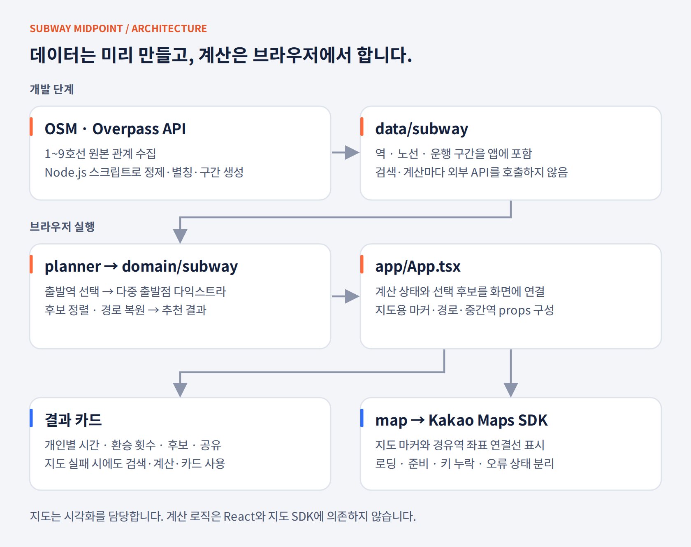
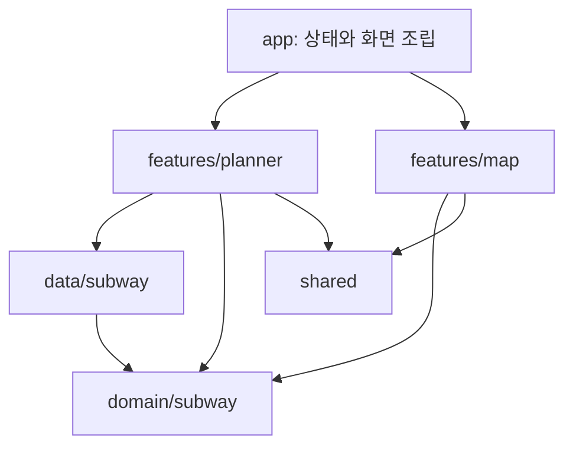

# 아키텍처 · 계산과 화면의 경계

[폴더·설정 안내](STRUCTURE.md) · [개발 가이드](DEVELOPMENT.md) · [문서 목록](README.md)

**추천 계산은 UI와 지도 SDK 없이 실행할 수 있고, App이 결과를 화면에 연결합니다.** 지도 로딩 실패가 추천 계산의 실패로 이어지지 않도록 책임을 나눴습니다.

뒤쪽의 [도메인 지도](#도메인-지도) · [핵심 프로세스](#핵심-프로세스) · [왜 다익스트라와 이진 힙인가](#왜-다익스트라와-이진-힙인가) · [설계 트레이드오프](#설계-트레이드오프) · [변경 영향 범위](#변경-영향-범위) · [문제 추적 순서](#문제-추적-순서)는 "어디를 고치면 어디까지 바뀌는가"와 "결과가 이상하면 어디부터 보는가"에 답하기 위한 절입니다.

## 구조를 나눈 이유

| 해결할 문제 | 구조 선택 | 확인할 효과 |
| --- | --- | --- |
| 지도 API 실패가 전체 기능을 막는 문제 | 계산 도메인과 지도 SDK 상태 분리 | 키 없이도 검색·계산과 테스트 실행 |
| 입력 변경 뒤 이전 결과가 남는 문제 | reducer에서 입력과 결과를 함께 전이 | 조건 변경 시 결과·오류 초기화 |
| 공유받은 사람이 역을 다시 입력하는 문제 | URL 변환 함수와 초기 상태 복원 | 같은 조건·선택 후보로 시작 |
| 기능 간 수정 범위가 커지는 문제 | App에서 planner·map 조립, import 경계 검사 | 기능 간 직접 호출 제한 |

## 실행 시점

| 시점 | 처리 | 외부 서비스 의존 |
|---|---|---|
| 개발자가 데이터 갱신 | OSM 관계 수집·정제 → TypeScript 데이터 생성 | Overpass API |
| 앱 모듈 로드 | 정적 데이터로 그래프와 검색 카탈로그 구성 | 없음 |
| 앱 첫 로드 | 주소 쿼리(`?from=`)가 있으면 출발역 복원과 계산을 초기 상태에서 수행 | 없음 |
| 출발역 검색·계산 | 카탈로그 검색 → 출발지별 다익스트라 → 후보 정렬 → 상위 후보만 경로 복원 | 없음 |
| 결과 시각화 | App이 마커·경로·중간역을 지도 props로 변환 | Kakao Maps SDK |

## 의존 관계

- `domain`은 React·UI·생성 데이터에 의존하지 않습니다. 실제 데이터로 확인하는 테스트는 별도입니다.
- `data`는 도메인 타입과 그래프·카탈로그 함수를 사용합니다.
- planner와 map은 서로 직접 호출하지 않습니다. `App.tsx`가 연결합니다.
- `shared`는 앱·기능·지하철 데이터에 의존하지 않습니다.

주요 import 경계는 [ESLint 규칙](../eslint.config.js)으로 검사합니다. 실제 경로는 [폴더 안내](STRUCTURE.md)에서 확인할 수 있습니다.

## 상태와 오류의 경계

[plannerReducer](../src/features/planner/model/plannerReducer.ts)는 출발지, 결과, 선택 후보, 계산 오류를 관리합니다. 입력 조건이 바뀌면 기존 결과를 초기화하고, 후보 변경은 같은 결과 안의 선택만 바꿉니다. [urlState](../src/features/planner/model/urlState.ts)는 주소 쿼리와 출발역·후보 사이의 변환만 담당하고, 주소 읽기·쓰기는 `usePlanner`가 수행합니다.

[KakaoMap](../src/features/map/ui/KakaoMap.tsx)은 로딩·준비·키 누락·SDK 오류 상태를 관리합니다. 계산 상태와 지도 상태를 따로 두기 때문에 키가 없어도 카드 결과를 확인할 수 있습니다. [SDK 로더](../src/features/map/api/kakaoLoader.ts)는 공유 Promise로 중복 로딩 요청을 모읍니다.

## 표시와 데이터

검색어 강조는 React 텍스트 요소로 나눠 표시합니다. 지도 커스텀 오버레이에 들어가는 이름은 HTML 이스케이프 후 삽입합니다. 위치 권한은 현재 위치 버튼을 누른 시점에 요청하며 추천의 출발역 선택을 대신하지 않습니다.

시간 가중치와 후보 정렬의 구체적인 규칙은 [계산 기준](DEVELOPMENT.md#계산-기준)에 정리했습니다.

## 도메인 지도

코드에 실제로 있는 타입 이름 기준입니다. "노드"는 노선별 물리 정류장, "역"은 사용자가 고르는 단위이며, 둘을 잇는 것은 `stationKey` 하나입니다.

| 타입 (파일) | 뜻 | 핵심 필드 | 쓰는 곳 |
| --- | --- | --- | --- |
| `RawStation` ([types.ts](../src/domain/subway/types.ts)) | 노선별 노드. 환승역은 노선마다 하나씩 | `id`, `name`, `lineId`, `latitude`·`longitude`, `transferName`(다른 이름의 환승역 묶기, 동명이역 분리), `aliases`(검색 전용) | 생성 데이터 `RAW_STATIONS` |
| `LineSegment` ([types.ts](../src/domain/subway/types.ts)) | 한 노선의 운행 구간. 배열 순서가 운행 순서 | `lineId`, `stationIds`, `loop`(2호선 순환) | 생성 데이터 `LINE_SEGMENTS` |
| `SubwayLine` ([types.ts](../src/domain/subway/types.ts)) | 노선 표시 정보 | `id`, `name`, `color`, `badge` | [lines.ts](../src/data/subway/lines.ts), 배지 |
| `GraphEdge` ([graph.ts](../src/domain/subway/graph.ts)) | 가중 간선 | `to`, `minutes`, `kind: 'LINE' \| 'TRANSFER'` | 다익스트라, 환승 횟수 |
| `SubwayGraph` ([graph.ts](../src/domain/subway/graph.ts)) | 계산용 그래프 | `nodes`(id → `RawStation`), `adj`(id → `GraphEdge[]`), `nodesByName`(역 키 → 노드 id 목록) | `dijkstra`, `calculateMidpoint` |
| `Station` ([types.ts](../src/domain/subway/types.ts)) | 사용자가 고르는 "역". 같은 키의 노드 묶음 | `key`(URL `from` 값이자 `nodesByName` 키), `name`(가장 짧은 이름), `lineIds`, `nodeIds`(출발지 묶음으로 그대로 전달) | 검색 카탈로그, reducer, URL |
| `StationCatalog` ([catalog.ts](../src/domain/subway/catalog.ts)) | 검색·복원용 역 목록 | `stations`(이름순), `byKey` | `searchStations`, `parsePlannerQuery` |
| `DijkstraResult` ([dijkstra.ts](../src/domain/subway/dijkstra.ts)) | 출발지 하나의 탐색 결과 | `dist`(도달 불가는 `Infinity`), `prev` | 점수 계산, 경로 복원 |
| `MidpointCandidate` ([midpoint.ts](../src/domain/subway/midpoint.ts)) | 추천 후보 역 | `stationKey`, `name`, `lineIds`, `maxMinutes`(정렬 1순위), `totalMinutes`(2순위), `legs` | 결과 카드, 지도 경로 |
| `Leg` ([midpoint.ts](../src/domain/subway/midpoint.ts)) | 출발지 하나 → 후보의 경로 | `index`(출발지 순서), `fromId`·`toId`, `minutes`, `transfers`, `nodeIds`, `points` | 개인별 시간·환승 표시, 지도 선 |
| `MidpointResult` ([midpoint.ts](../src/domain/subway/midpoint.ts)) | 계산 결과 | `best`(= `candidates[0]`), `candidates`(점수순 상위 `topN`) | reducer `result` |
| `PlannerState` ([plannerReducer.ts](../src/features/planner/model/plannerReducer.ts)) | 화면 상태 | `departures`(2~6칸), `result`, `selectedCandidate`, `error` | `usePlanner`, 패널·카드 |

데이터 규모(2026-11-09, 테스트 환경에서 `subwayGraph` 집계): 노선 13개, 역 509개, 노선별 노드 606개, 운행 구간 149개, LINE 간선 1,202개(양방향 포함), TRANSFER 간선 222개.

## 핵심 프로세스

계산 버튼을 누르거나 `?from=` 주소로 열 때 한 번 흐르는 순서입니다. 1~2는 앱 로드 시 한 번, 3~8은 계산마다 실행합니다.

1. **데이터 생성(개발 시점)**: [fetch-stations.mjs](../scripts/fetch-stations.mjs)가 OSM 관계를 정제해 `RAW_STATIONS`·`LINE_SEGMENTS`를 만든다. 급행 제외, 괄호 부기 제거, `transferName` 지정, 동명이역 분리가 여기서 끝난다.
2. **그래프·카탈로그 구성(모듈 로드)**: [data/subway/index.ts](../src/data/subway/index.ts)가 `buildSubwayGraph`와 `buildStationCatalog`를 한 번 호출한다. 중복 id·없는 역·노선이 섞인 구간은 여기서 throw 한다.
3. **입력**: [DepartureField](../src/features/planner/ui/DepartureField.tsx)가 `searchStations`로 후보를 보여 주고, 선택하면 reducer `select`로 `Station`이 들어간다. 입력이 바뀌면 `invalidate`가 결과를 지운다. 주소로 열면 [parsePlannerQuery](../src/features/planner/model/urlState.ts)가 `byKey`로 역을 복원한다.
4. **그래프 조회**: [usePlanner](../src/features/planner/model/usePlanner.ts)가 각 출발 `Station.nodeIds`를 `calculateMidpoint`에 넘긴다. 함수 안에서 `stationKey`로 같은 역을 하나로 합치고, 2곳 미만이면 `null`을 돌려준다.
5. **계산**: 출발지마다 `dijkstra(graph, nodeIds)`를 한 번씩 실행한다(최대 6회). 환승역은 모든 노선 노드가 비용 0 출발점이다.
6. **점수·정렬**: `nodesByName`의 역마다 출발지별 최소 `dist`를 모아 `maxMinutes`·`totalMinutes`를 만든다. 출발역과 한 명이라도 못 닿는 역은 제외하고 `max → total → 이름순`으로 정렬한다.
7. **상위 경로 복원**: 상위 `topN`(기본 3)에만 `restorePath`로 노드 경로를 만들고 환승 횟수·좌표를 붙인다. 복원이 비면 `PathRestoreError`를 던진다.
8. **상태·URL 반영**: reducer `computed`가 결과를 저장하고 첫 후보를 선택한다. `usePlanner`의 effect가 `buildPlannerQuery`로 `?from=키,키&pick=n`을 `history.replaceState`에 쓴다. [App](../src/app/App.tsx)이 선택 후보의 `legs`를 지도 마커·경로 props로 바꾼다.

## 왜 다익스트라와 이진 힙인가

| 선택지 | 쓰지 않은 이유 |
| --- | --- |
| BFS | 간선 가중치가 균일하지 않다. 역 간 시간은 거리 기반(최소 1.5분)이고 환승은 5분이라 홉 수 최소화가 시간 최소화가 아니다. |
| 배열 선형 탐색 다익스트라 | 노드 606개·간선 1,424개에서 매 단계 최소값을 선형으로 찾으면 O(V²)이고, 노선을 더 넣을수록 커진다. 이진 힙으로 O((V+E) log V)를 유지한다. |
| 플로이드–워셜(전체 쌍) | 출발지는 최대 6곳이고 데이터가 바뀌면 다시 계산해야 하므로 전체 쌍 테이블은 과하다. 출발지 수만큼 단일 출발 탐색이 가장 작다. |
| 그래프 라이브러리 | 다중 출발점(환승역 노드 묶음), 역 단위 도착 판정, 출발역 제외 같은 도메인 규칙을 함수 안에서 그대로 다루려고 [직접 구현](../src/domain/subway/dijkstra.ts)했다. 의존성 없이 테스트가 돌고 원인 추적이 함수 하나로 끝난다. |

힙 구현은 `push`에서 부모와 비교하며 올리고, `pop`에서 자식 중 작은 쪽과 바꾸며 내린다. 같은 노드가 여러 번 들어갈 수 있으므로 꺼냈을 때 `cost > dist[id]`면 버린다. 이 두 규칙이 [dijkstra.test](../src/domain/subway/dijkstra.test.ts)의 "우회가 더 싸면 우회를 고른다"와 "도달 불가는 Infinity"로 고정돼 있습니다.

## 설계 트레이드오프

| 결정 | 선택 | 대안 | 선택 이유와 비용 |
| --- | --- | --- | --- |
| 상태 관리 | `useReducer` + 훅 하나 | Redux·Zustand 등 스토어 | 상태가 `departures`·`result`·`selectedCandidate`·`error` 네 가지뿐이고 화면도 하나다. 전이 규칙(입력 변경 → 결과 무효화)을 순수 함수로 테스트하려는 목적은 reducer로 충분하다. 화면이 늘어 상태를 여러 트리에서 읽어야 하면 그때 스토어를 검토한다. |
| 계산 위치 | 브라우저 | 서버 API | 데이터가 정적(수백 KB)이고 다익스트라 6회가 ms 단위라 서버가 필요 없다. 비용은 데이터 갱신 시 재배포가 필요하다는 점과 번들 크기다. 실시간 시각표를 쓰려면 이 결정부터 바뀐다. |
| 스타일 | CSS Modules + 토큰 CSS | Tailwind·CSS-in-JS | 런타임 의존성 없이 클래스 충돌만 막으면 되고, 색·간격 기준은 [tokens.css](../src/app/styles/tokens.css) 한 곳에서 관리한다. 비용은 유틸리티 클래스보다 파일 수가 많다는 점이다. |
| 소요시간 | 거리 기반 추정(32km/h, 최소 1.5분, 환승 5분) | 실제 시각표·실시간 API | 외부 API 없이 결정적으로 테스트할 수 있고 오프라인 빌드가 가능하다. 비용은 실제 운행시간과의 오차이며, README의 "현재 한계"에 명시한다. |
| 경로 복원 범위 | 상위 `topN`만 | 모든 후보 | 정렬에는 `max`·`total`만 필요하다. 전체 복원은 후보 수 × 출발지 수만큼 배열·좌표를 만든다. 비용은 "4등 후보 보기" 같은 기능을 추가할 때 `topN`을 올려야 한다는 점이다. |
| 역 단위 | 이름 기반 `stationKey` | OSM 노드 id | 같은 역을 노선 수만큼 노드로 두되 사용자에게는 하나로 보이게 하려면 묶음 키가 필요하다. 비용은 동명이역(신촌·양평)을 `transferName`으로 수동 분리해야 한다는 점이고, 800m 거리 검사와 데이터 테스트로 막는다. |
| 기능 간 결합 | `App`에서 조립, ESLint import 경계 | 기능끼리 직접 import | planner가 map을 몰라야 지도 없이 테스트할 수 있다. 비용은 `App.tsx`에 변환 코드(`markers`·`routes`)가 모인다는 점이다. |

## 변경 영향 범위

"이 변경이 어디까지 번지는가"를 먼저 답할 수 있게 정리했습니다.

| 변경 | 고치는 곳 | 같이 바뀌어야 하는 테스트·문서 | 바뀌지 않는 곳 |
| --- | --- | --- | --- |
| 노선 추가 | [fetch-stations.mjs](../scripts/fetch-stations.mjs)의 노선 목록·키 분리 표 → `npm run data:stations` → [lines.ts](../src/data/subway/lines.ts)에 id·색·배지 | [stations.test.ts](../src/data/subway/stations.test.ts)의 종점·환승 묶음·새 노선 연결 항목, README·PROJECT의 노선 수와 역 수, [VALIDATION](VALIDATION.md) 데이터 표 | `domain/*`, reducer, URL 규칙, 지도 |
| 환승 비용 변경 | [graph.ts](../src/domain/subway/graph.ts)의 `TRANSFER_MINUTES` 한 곳 | [graph.test](../src/domain/subway/graph.test.ts)·[midpoint.test](../src/domain/subway/midpoint.test.ts)는 상수를 참조하므로 그대로 통과. 실제 데이터로 기대 역을 고정한 테스트와 README·DEVELOPMENT의 "환승 5분" 표기 확인 | 다익스트라, 정렬, 화면 |
| 공용 승강장 환승 비용 0 | `buildSubwayGraph`의 환승 간선 생성부에 노선 쌍별 예외 | 새 그래프 테스트, [DEVELOPMENT](DEVELOPMENT.md#그래프와-시간-가중치) 표, `countTransfers`가 노선 변경을 여전히 환승으로 셀지 결정 | 카탈로그, URL |
| 정렬 규칙 변경(예: 합계 우선) | [midpoint.ts](../src/domain/subway/midpoint.ts)의 `scored.sort` 비교 함수 | `calculateMidpoint (ranking rule)` 테스트의 기대 순서, README·PROJECT·DEVELOPMENT의 "추천 기준", e2e의 기대 역명이 있으면 함께 | 그래프, 다익스트라, URL |
| 출발지 최대 수 변경 | [plannerReducer.ts](../src/features/planner/model/plannerReducer.ts)의 `MAX_DEPARTURES`(색이 반복되지 않게 하려면 `DEPARTURE_COLORS`도) | reducer·urlState 테스트, 패널 레이아웃 확인 | 도메인 전체 |
| URL 파라미터 이름 변경 | [urlState.ts](../src/features/planner/model/urlState.ts)의 `FROM_PARAM`·`PICK_PARAM` | urlState 테스트, e2e의 주소 단언, README 공유 예시. 이미 공유된 주소는 깨진다 | 도메인, 지도 |
| 지도 SDK 교체 | [features/map](../src/features/map/) 전체 | e2e는 키 없는 빌드라 영향 적음. [OPERATIONS](OPERATIONS.md) 지도 설정 | planner, domain (`App`의 props 변환만 조정) |

## 문제 추적 순서

추천 결과가 이상할 때 위에서부터 확인합니다. 각 단계는 앞 단계가 맞다는 전제에서만 의미가 있습니다.

1. **입력이 의도한 역인가**: 주소의 `from` 값을 `stationCatalog.byKey[키]`로 조회한다. 신촌이면 `신촌`(2호선)과 `신촌(경의중앙)`은 다른 역이다. 중복·모르는 역은 파싱에서 조용히 버려지므로 입력칸 수가 기대와 다르면 여기다.
2. **데이터가 맞는가**: `npm test`로 [stations.test.ts](../src/data/subway/stations.test.ts)를 돌린다. 노드·구간·환승 묶음 문제는 여기서 걸린다. 통과하는데 특정 구간이 의심되면 `subwayGraph.adj['l1_구로']`처럼 인접 목록을 직접 본다.
3. **그래프 간선이 맞는가**: 두 역 사이 `GraphEdge.minutes`가 거리와 맞는지, 환승 간선이 다른 노선끼리만 있는지 본다. 1호선 분기 오결합은 과거 여기서 났다.
4. **단일 출발 거리가 맞는가**: `dijkstra(subwayGraph, station.nodeIds).dist[목표노드]`를 출발지 하나씩 확인한다. `Infinity`면 연결이 끊긴 것이다.
5. **점수와 정렬이 맞는가**: `calculateMidpoint(..., { topN: 20 })`으로 후보를 넓혀 `maxMinutes`·`totalMinutes`를 비교한다. 기대 역이 빠져 있으면 출발역이거나 한 명이 못 닿는 역이다.
6. **경로 복원이 맞는가**: `legs[i].nodeIds`의 첫 노드가 출발 `nodeIds` 안에 있고 마지막이 `toId`인지 본다. `PathRestoreError`가 나면 `dist`와 `prev`가 어긋난 것이며 다익스트라 수정 이력을 먼저 의심한다.
7. **화면 상태가 맞는가**: reducer의 `result`와 `selectedCandidate`, 주소의 `pick`을 비교한다. 결과가 남아 있는데 입력이 바뀌었다면 `invalidate`를 거치지 않은 액션이 추가된 것이다.
8. **지도만 다른가**: 카드 숫자가 맞고 지도 선만 이상하면 `App.tsx`의 `routes` 변환이나 [KakaoMap](../src/features/map/ui/KakaoMap.tsx)의 문제다. 지도는 계산 결과를 바꾸지 않는다.
