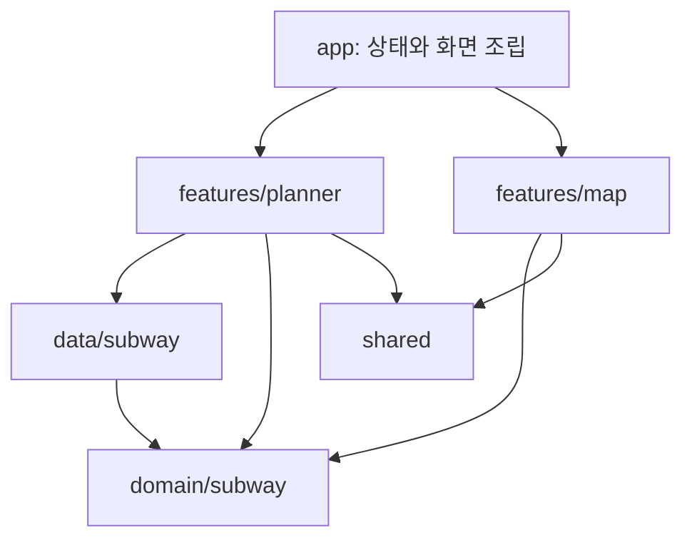

# 아키텍처 · 계산과 화면의 경계

[폴더·설정 안내](STRUCTURE.md) · [개발 가이드](DEVELOPMENT.md) · [문서 목록](README.md)

**추천 계산은 UI와 지도 SDK 없이 실행할 수 있고, App이 결과를 화면에 연결합니다.** 지도 로딩 실패가 추천 계산의 실패로 이어지지 않도록 책임을 나눴습니다.

## 실행 시점

| 시점 | 처리 | 외부 서비스 의존 |
|---|---|---|
| 개발자가 데이터 갱신 | OSM 관계 수집·정제 → TypeScript 데이터 생성 | Overpass API |
| 앱 모듈 로드 | 정적 데이터로 그래프와 검색 카탈로그 구성 | 없음 |
| 출발역 검색·계산 | 카탈로그 검색 → 출발지별 다익스트라 → 후보 정렬·경로 복원 | 없음 |
| 결과 시각화 | App이 마커·경로·중간역을 지도 props로 변환 | Kakao Maps SDK |

## 의존 관계

- `domain`은 React·UI·생성 데이터에 의존하지 않습니다. 실제 데이터로 확인하는 테스트는 별도입니다.
- `data`는 도메인 타입과 그래프·카탈로그 함수를 사용합니다.
- planner와 map은 서로 직접 호출하지 않습니다. `App.tsx`가 연결합니다.
- `shared`는 앱·기능·지하철 데이터에 의존하지 않습니다.

주요 import 경계는 [ESLint 규칙](../eslint.config.js)으로 검사합니다. 실제 경로는 [폴더 안내](STRUCTURE.md)에서 확인할 수 있습니다.

## 상태와 오류의 경계

[plannerReducer](../src/features/planner/model/plannerReducer.ts)는 출발지, 결과, 선택 후보, 계산 오류를 관리합니다. 입력 조건이 바뀌면 기존 결과를 초기화하고, 후보 변경은 같은 결과 안의 선택만 바꿉니다.

[KakaoMap](../src/features/map/ui/KakaoMap.tsx)은 로딩·준비·키 누락·SDK 오류 상태를 관리합니다. 계산 상태와 지도 상태를 따로 두기 때문에 키가 없어도 카드 결과를 확인할 수 있습니다. [SDK 로더](../src/features/map/api/kakaoLoader.ts)는 공유 Promise로 중복 로딩 요청을 모읍니다.

## 표시와 데이터

검색어 강조는 React 텍스트 요소로 나눠 표시합니다. 지도 커스텀 오버레이에 들어가는 이름은 HTML 이스케이프 후 삽입합니다. 위치 권한은 현재 위치 버튼을 누른 시점에 요청하며 추천의 출발역 선택을 대신하지 않습니다.

시간 가중치와 후보 정렬의 구체적인 규칙은 [계산 기준](DEVELOPMENT.md#계산-기준)에 정리했습니다.
