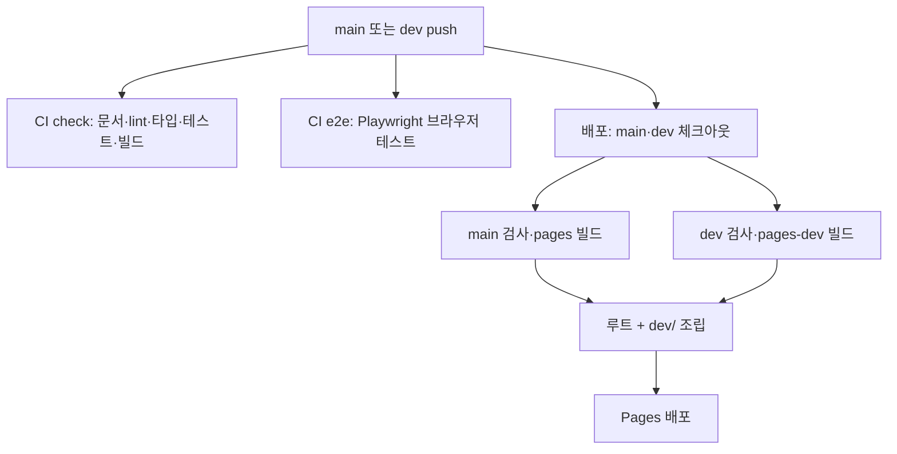

# 개발 가이드 · 실행, 계산 규칙, 데이터, 운영, 변경 절차

[저장소 홈](../README.md) · [프로젝트 설명](PROJECT.md) · [검증 기록](VALIDATION.md)

**추천 결과를 재현하고 계산·데이터·화면 상태의 규칙, 지도 설정·배포, 커밋 절차를 확인하는 문서입니다.** 설계 이유와 구조는 [프로젝트 설명](PROJECT.md), 실행 결과는 [검증 기록](VALIDATION.md)에 있습니다.

## 로컬 실행

Node.js 22 이상에서 저장소 루트 기준으로 실행합니다. nvm 사용자는 `nvm use`로 버전을 맞춥니다.

```bash
npm ci
npm run dev
```

[로컬 앱](http://localhost:5173/)에서 출발역을 선택하고 계산합니다. 지도 키가 없어도 검색과 결과 카드는 사용할 수 있습니다. 지도는 [지도 설정](#지도-설정)을 따릅니다.

| 명령 | 확인 내용 |
| --- | --- |
| `npm run check` | lint·타입·단위 테스트·문서 링크·루트 빌드 |
| `npm run docs:check` | Markdown 상대 파일 링크·닫힌 코드 블록 (외부 URL·앵커는 검사하지 않음) |
| `npm test` | Node 환경의 `.test.ts` 단위·회귀 테스트 |
| `npm run test:e2e` | 지도 키 없는 빌드를 preview 서버로 띄워 Playwright로 검색·계산·후보·주소 복원·공유·모바일 패널 확인. 처음에는 `npx playwright install chromium` |
| `npx vite build --mode pages` / `--mode pages-dev` | 운영 `/subway-midpoint/` · 개발 `/subway-midpoint/dev/` 경로 빌드 |
| `npm run data:stations` / `node scripts/fetch-stations.mjs --cached` | 역 데이터 재생성 / 원본 캐시 `.cache/overpass-lines.json` 재사용 |

Playwright 테스트는 [e2e/](../e2e/)에 있고 설정은 [playwright.config.ts](../playwright.config.ts)입니다. 실제 한글 IME 조합, 시스템 테마, 지도 키가 있는 렌더링은 수동으로 확인합니다.

## 계산 기준

후보 정렬·제외 규칙은 [README 추천 기준](../README.md#추천-기준)을 따릅니다. [calculateMidpoint](../src/domain/subway/midpoint.ts)가 제외 조건을 적용하고, `scored.sort`에서 최대 시간 → 합계 → 한국어 이름순으로 정렬합니다. 기본 반환값은 상위 3개이며 추천역도 이 목록에 포함합니다. 동일 출발역은 계산 함수에서 역 키로 중복 제거하고 UI에서도 중복 선택을 제한합니다.

`calculateMidpoint`는 각 출발지의 다익스트라 결과를 만든 뒤 후보별 도착 노드와 최대·합계 시간만 모아 정렬합니다. 경로 복원과 좌표 변환은 상위 N개 후보에만 수행하고, 복원한 경로가 비어 있으면 `PathRestoreError`를 발생시킵니다. 후보의 표시 이름은 같은 역의 노선별 이름 중 가장 짧은 것(카탈로그와 같은 규칙), 노선 목록은 역 키로 묶인 모든 노드의 노선입니다. 전체 흐름은 [핵심 프로세스](PROJECT.md#핵심-프로세스)에 있습니다.

### 그래프와 시간 가중치

| 요소 | 현재 구현 |
|---|---|
| 역 노드 | 환승역도 노선별 노드로 유지 |
| 운행 간선 | 같은 구간에서 이웃한 역을 양방향 연결 |
| 순환 | 구간에 `loop`가 있으면 끝과 시작 연결; 생성 데이터는 원본 정차 순서도 사용 |
| 환승 간선 | 정규화 이름 또는 `transferName`으로 묶인 다른 노선 연결 |
| 역 간 시간 | `max(1.5, haversine 거리(km) / 32 × 60)`분 |
| 환승 시간 | 노선 변경당 5분 (`TRANSFER_MINUTES`) |

그래프 생성 시 중복 ID, 존재하지 않는 역 참조, 구간과 다른 노선에 속한 역을 확인하고 오류를 발생시킵니다. 총신대입구·이수처럼 이름이 다른 환승역은 `transferName`으로 연결합니다.

[다익스트라](../src/domain/subway/dijkstra.ts)는 이진 최소 힙을 사용합니다. 환승역의 모든 노선 노드를 비용 0으로 시작해 첫 노선 선택에는 환승 비용을 붙이지 않습니다. 이미 더 짧은 경로가 발견된 힙 항목은 건너뜁니다. 다른 선택지와의 비교는 [왜 다익스트라와 이진 힙인가](PROJECT.md#왜-다익스트라와-이진-힙인가)에 있습니다.

실제 시각표·열차 대기·역별 환승 동선을 반영한 시간은 아닙니다. 이 모델 안에서의 최단 예상 시간을 비교합니다.

## 역 데이터

[stations.ts](../src/data/subway/stations.ts)는 [생성 스크립트](../scripts/fetch-stations.mjs)의 결과입니다. 데이터는 생성 스크립트를 다시 실행해 갱신하며, 정제 방식이 달라질 때는 생성 규칙도 수정합니다. 캐시가 없으면 새로 요청하며, 최초 수집에는 네트워크가 필요하고 실패하면 다른 Overpass 서버로 재시도합니다.

| 원본 조건 | 정제 방법 |
|---|---|
| `route=subway` ref 1~9, `route=train` ref 경의·중앙/수인·분당/신분당/공항철도 | 관계의 정차 순서로 운행 구간 생성 |
| 급행·특급·직통 | 정차역을 건너뛰는 간선을 막기 위해 제외 |
| 괄호 부기 | 표시 이름에서 제거하고 원래 이름을 검색 별칭으로 보존 |
| 같은 노선의 중복 역 | 정규화 이름으로 통합, 연속 중복 정차 노드 정리 |
| 이름이 다른 환승역 | `transferName`으로 묶음 지정 (총신대입구 → 이수) |
| 이름만 같은 다른 역 | 노선별 다른 키를 `transferName`에 지정해 분리 (경의중앙선 신촌·양평). 같은 키의 노드가 800m 이상 떨어지면 스크립트가 경고 |

[데이터 테스트](../src/data/subway/stations.test.ts)는 노선 범위·중복·좌표·참조·종점·주요 환승 묶음·동명이역 분리·환승 묶음 거리·새 노선 연결을 확인합니다. 노선 id와 색·배지 글자는 [lines.ts](../src/data/subway/lines.ts)에 두며, 번호가 아닌 노선은 짧은 이름 배지로 표시합니다. 갱신 후 실패하면 실제 노선 변화인지 원본 누락인지 먼저 확인합니다. 출처와 ODbL 조건은 [OpenStreetMap 저작권 안내](https://www.openstreetmap.org/copyright)에서 확인합니다.

## React 상태와 검색

[usePlanner](../src/features/planner/model/usePlanner.ts)가 계산과 reducer를 연결합니다. 입력칸은 2~6개이며 서로 다른 역이 2곳 이상 선택되면 계산할 수 있습니다. 나머지 입력칸이 비어 있어도 선택한 역을 기준으로 계산합니다.

| 조작 | 상태 변화 |
|---|---|
| 출발지 추가·삭제·검색어 변경·선택·지우기 | 출발지 갱신, 결과·오류·선택 후보 초기화 |
| 계산 성공 | 결과 저장, 첫 후보 선택 |
| 계산 실패 | 결과 제거, 오류 저장 |
| 후보 전환 | 결과를 유지하고 선택 인덱스 변경 |

처음 열 때 주소에 `?from=`이 있으면 [urlState](../src/features/planner/model/urlState.ts)로 출발역을 복원하고, 2곳 이상이면 계산까지 마친 상태로 시작합니다. URL의 `from`에는 표시 이름이 아닌 역 키가 들어갑니다. 예를 들어 경의중앙선 신촌은 `신촌(경의중앙)`으로 2호선 신촌과 구분합니다. `pick`은 0부터 시작하는 후보 인덱스이므로 `pick=1`은 두 번째 후보입니다. 결과가 있는 동안에는 출발역과 선택 후보를 `history.replaceState`로 주소에 반영하고, 결과가 사라지면 쿼리도 지웁니다.

[DepartureField](../src/features/planner/ui/DepartureField.tsx)는 combobox·listbox·option과 ARIA 상태를 사용합니다. 방향키·Enter·Escape를 처리하고 한글 조합 중에는 선택 처리를 건너뜁니다. 검색어 강조는 HTML 삽입 없이 문자열을 React 요소로 나눕니다.

[ResultCard](../src/features/planner/ui/ResultCard.tsx)의 공유 버튼은 Web Share API가 있으면 공유 시트를, 없으면 클립보드를 사용합니다. 결과 텍스트와 함께 같은 조건으로 열리는 주소를 전달합니다. 후보 칩은 ARIA 탭 패턴을 따라 선택된 칩만 Tab 순서에 두고 방향키·Home·End로 옮깁니다.

## 지도 설정

로컬에서는 `.env.example`을 `.env`로 복사하고 `VITE_KAKAO_MAP_KEY`에 Kakao JavaScript 키를 넣습니다. GitHub Actions는 저장소 변수 `KAKAO_MAP_KEY`를 빌드 환경변수 `VITE_KAKAO_MAP_KEY`로 전달합니다. 카카오 개발자 콘솔의 Web 허용 도메인에 실행할 도메인을 등록합니다.

| 환경 | 등록할 도메인 |
|---|---|
| 로컬 | `http://localhost:5173` |
| GitHub Pages 운영·개발 | `https://minsangkwak.github.io` |
| 다른 호스팅 | 해당 서비스 도메인 |

`og:url`·`og:image`는 절대 주소가 필요합니다. `pages`·`pages-dev` 모드는 [Vite 설정](../vite.config.ts)이 저장소 주소를 넣고, 다른 호스팅에서는 `VITE_SITE_URL`을 설정합니다. 미리보기 이미지는 `public/og.png`입니다.

JavaScript 키는 클라이언트 번들에 포함되므로 허용 도메인과 사용량을 카카오 개발자 콘솔에서 관리합니다. 키를 바꾸면 다시 빌드하고, 도메인 설정만 바꾸면 새로고침 후 SDK 응답을 확인합니다. 지도 키가 없어도 검색·계산은 동작합니다.

## CI와 배포

**GitHub Pages 배포물 하나에 운영과 개발 미리보기를 함께 넣습니다.** 어느 브랜치에서 배포가 시작되어도 실행 시점의 main과 dev를 각각 체크아웃하고 빌드합니다.

| 브랜치 | 주소 | 빌드 모드 | base |
|---|---|---|---|
| main | [운영 서비스](https://minsangkwak.github.io/subway-midpoint/) | `pages` | `/subway-midpoint/` |
| dev | [개발 미리보기](https://minsangkwak.github.io/subway-midpoint/dev/) | `pages-dev` | `/subway-midpoint/dev/` |



[CI](../.github/workflows/ci.yml)는 PR과 main·dev push에서 두 job을 실행합니다. `check`는 문서 검사·lint·타입·테스트·운영 경로 빌드, `e2e`는 Chromium을 설치한 뒤 지도 키 없는 빌드로 Playwright 테스트를 수행하고 실패 시 추적 파일을 아티팩트로 남깁니다. [배포](../.github/workflows/deploy.yml)는 push와 수동 실행을 지원하고, 각 브랜치에서 설치·타입·테스트·빌드를 수행합니다.

**두 워크플로는 독립적입니다.** 배포가 별도 CI 성공을 기다리는 설정은 없고 배포 단계 자체의 검사를 사용합니다. Pages 배포 성공과 실제 지도 API 동작도 별도로 확인해야 합니다.

| 설정 | 값 |
|---|---|
| Node | 22, `npm ci` |
| 배포 환경 | `github-pages` (보호 규칙에 배포를 시작하는 main·dev 허용 필요) |
| 동시 실행 | `pages` 그룹, 이전 실행 취소 |

base는 [Vite 설정](../vite.config.ts)에서 정합니다. 문서만 변경해도 현재 조건에서는 CI와 배포가 실행됩니다. 기본 `npm run build`는 base `/`로 빌드하므로 다른 루트 호스팅에도 사용할 수 있지만 환경변수와 허용 도메인은 따로 설정해야 합니다.

## 변경 절차와 커밋

**한 커밋에서 해결하는 문제를 분명히 하고, 변경 이유와 확인 결과를 남깁니다.** 이전 커밋 메시지는 다시 쓰지 않고 새 변경을 구분해 기록합니다.

1. 최신 dev에서 작업 브랜치를 만들고 관련 코드·스타일·테스트·문서를 함께 수정합니다.
2. `npm run check`를 실행하고, 화면·상태 변경이면 `npm run test:e2e`와 필요한 수동 확인을 수행합니다.
3. 목적별 커밋을 작성하고 dev 대상 PR을 엽니다. CI·배포 결과를 각각 확인합니다.
4. 개발 미리보기에서 검색·계산·후보·지도·모바일을 확인한 뒤 dev → main PR을 병합합니다.
5. 운영 배포 후 같은 핵심 흐름을 확인합니다.

| 기록할 내용 | 예시 |
| --- | --- |
| 문제와 조건 | 같은 이름의 두 역이 환승역으로 묶임 |
| 선택한 해결책 | 노선별 역 키 분리와 거리 검사 추가 |
| 확인 근거 | 동명이역 회귀 테스트, 기존 추천 결과 검사 |
| 남은 범위 | 공식 노선도 전수 대조 여부 |

| 변경 범위 | 메시지 예시 |
|---|---|
| planner 입력 상태 | `fix(planner): 출발역 변경 시 이전 결과 초기화` |
| 도메인 계산 | `fix(domain): 환승역 출발 시 첫 노선 선택 비용 제거` |
| 데이터 | `chore(data): 13개 노선 원본 갱신과 종점 검증` |
| 브라우저 테스트 | `test(e2e): 주소 복원과 공유 흐름 확인` |
| 문서 | `docs(project): 변경 영향 범위 표 추가` |
| 배포 | `ci(pages): 운영과 개발 빌드 경로 정리` |

위 예시는 변경 범위에 맞춘 커밋 제목 형식입니다. 파일 수보다 변경 목적을 기준으로 나누고, 이미지와 이를 참조하는 문서는 함께 커밋해 중간 상태의 링크가 깨지지 않게 합니다. PR에는 해결한 문제, 달라진 동작, 실행한 검사, 확인하지 못한 외부 연동을 적습니다. UI 변경이 있으면 실제 화면을 첨부합니다. 단순 문서 수정에 앱 버전을 올리지 않습니다.

### 파일 관리 기준

- 계산 규칙은 `domain`, 생성 결과는 `data`, 입력 상태는 `planner/model`, 지도 서비스 호출과 타입은 `map/api`, 지도 표시는 `map/ui`, 연결은 `app`에 둡니다.
- 단위 테스트는 구현 파일 옆에 `.test.ts`, 브라우저 테스트는 `e2e/*.spec.ts`, 컴포넌트 스타일은 CSS Modules로 둡니다.
- 생성된 역 파일을 손으로 수정하기보다 생성 스크립트를 고칩니다.
- 공통 모듈은 특정 기능에 의존하지 않도록 유지합니다. 의미 없이 재수출 파일이나 폴더별 설정을 추가하지 않습니다.
- 파일을 옮기면 import·문서 링크를 함께 수정하고 `npm run check`를 실행합니다.
- 환경변수 값·원본 캐시·빌드 결과·개인 설정은 커밋하지 않습니다.
- 문서만 바꿀 때는 상대 링크·코드 블록·본문 수치의 근거를 먼저 확인합니다. 테스트 결과를 새로 적으려면 실제 실행 결과 또는 해당 커밋의 CI 링크를 남기고, 성능·사용자 수·개선율에는 측정 환경·데이터 범위·날짜를 함께 남깁니다. 자동 검사와 지도 연동·접근성 수동 검사의 결과를 구분해 기록합니다.

## 문제 확인

운영·배포·도구에서 문제가 발생하면 아래 순서로 확인합니다. 추천 결과에 문제가 있으면 [문제 추적 순서](PROJECT.md#문제-추적-순서)를 따릅니다.

| 증상 | 확인 순서 |
|---|---|
| 지도 키 없음 | 환경변수 이름 → 빌드 시 값 전달 → 재빌드 여부 |
| SDK 401·로딩 실패 | JavaScript 키 → 허용 도메인 → 네트워크 응답 |
| 배포 작업 거부 | `github-pages` 환경의 허용 브랜치·보호 규칙 |
| 실행 취소 | 같은 `pages` 그룹의 최신 실행 |
| 파일 404 | 운영·개발 빌드 모드와 base 경로 |
| 데이터 테스트 실패 | 원본 운행 순서·급행 제외·별칭·동명이역 분리·실제 노선 변화 |
| e2e 실패 | 아티팩트의 trace → `npx playwright show-trace` → 셀렉터·문구 변경 여부 |
| 공유 미리보기 없음 | 빌드 모드와 `VITE_SITE_URL` → `og:image` 절대 주소 → `public/og.png` 포함 여부 |

SDK 문제는 현재 브라우저에서 재현하고, 확인 시점·주소·SDK 응답을 기록합니다. 과거 오류 기록과 현재 상태를 구분합니다.
