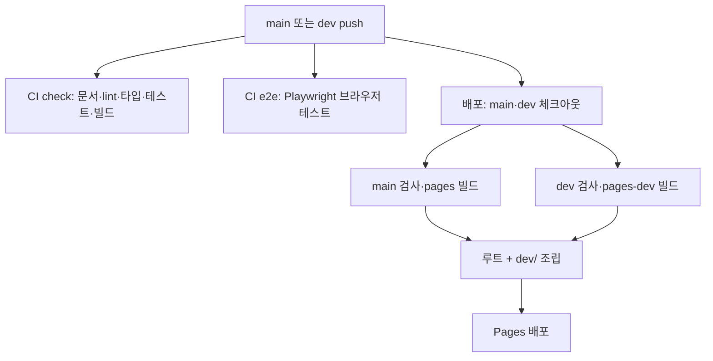

# 운영·배포 · 두 브랜치를 한 사이트에 배포하기

[개발 가이드](DEVELOPMENT.md) · [검증 기록](VALIDATION.md) · [문서 목록](README.md)

**GitHub Pages 배포물 하나에 운영과 개발 미리보기를 함께 넣습니다.** 어느 브랜치에서 배포가 시작되어도 실행 시점의 main과 dev를 각각 체크아웃하고 빌드합니다.

| 브랜치 | 주소 | 빌드 모드 |
|---|---|---|
| main | [운영 서비스](https://minsangkwak.github.io/subway-midpoint/) | `pages` |
| dev | [개발 미리보기](https://minsangkwak.github.io/subway-midpoint/dev/) | `pages-dev` |

## 운영에서 확인할 핵심

| 확인 항목 | 구현 방식 | 검토 근거 |
| --- | --- | --- |
| 운영·개발 환경 분리 | main과 dev를 각각 빌드해 경로별 배치 | 아래 브랜치·빌드 모드와 배포 흐름 |
| 외부 지도 오류 대응 | 키·SDK 실패를 계산 상태와 분리 | 지도 없이도 검색·결과 비교 가능 |
| 회귀 검사 | 단위 검사와 브라우저 검사를 별도 job으로 실행 | [검증 기록](VALIDATION.md) |
| 배포 판단 | 배포 내부 검사와 별도 CI 결과를 각각 확인 | CI 성공을 기다리는 배포 게이트는 미설정 |

## 지도 설정

로컬에서는 `.env.example`을 `.env`로 복사하고 `VITE_KAKAO_MAP_KEY`에 Kakao JavaScript 키를 넣습니다. GitHub Actions는 저장소 변수 `KAKAO_MAP_KEY`를 빌드 환경변수 `VITE_KAKAO_MAP_KEY`로 전달합니다.

카카오 개발자 콘솔의 Web 허용 도메인에 실행할 도메인을 등록합니다.

| 환경 | 등록할 도메인 |
|---|---|
| 로컬 | `http://localhost:5173` |
| GitHub Pages 운영·개발 | `https://minsangkwak.github.io` |
| 다른 호스팅 | 해당 서비스 도메인 |

`og:url`·`og:image`는 절대 주소가 필요합니다. `pages`·`pages-dev` 모드는 [Vite 설정](../vite.config.ts)이 저장소 주소를 넣고, 다른 호스팅에서는 `VITE_SITE_URL`을 설정합니다. 미리보기 이미지는 `public/og.png`입니다.

JavaScript 키는 클라이언트 번들에 포함되므로 서버 비밀키처럼 숨길 수 있는 값은 아닙니다. 허용 도메인과 사용량을 카카오 측에서 관리합니다. 키 값 변경은 재빌드가 필요하고, 도메인 설정만 바꾸면 새로고침 후 SDK 응답을 확인합니다. 지도 키가 없을 때도 검색·계산은 동작합니다.

## CI와 배포

[CI](../.github/workflows/ci.yml)는 PR과 main·dev push에서 두 job을 실행합니다. `check`는 문서 검사·lint·타입·테스트·운영 경로 빌드, `e2e`는 Chromium을 설치한 뒤 지도 키 없는 빌드로 Playwright 테스트를 수행하고 실패 시 추적 파일을 아티팩트로 남깁니다. [배포](../.github/workflows/deploy.yml)는 push와 수동 실행을 지원하고, 각 브랜치에서 설치·타입·테스트·빌드를 수행합니다.

**두 워크플로는 독립적입니다.** 배포가 별도 CI 성공을 기다리는 설정은 없고 배포 단계 자체의 검사를 사용합니다. Pages 배포 성공과 실제 지도 API 동작도 별도로 확인해야 합니다.

| 설정 | 값 |
|---|---|
| Node | 22, `npm ci` |
| 운영 base | `/subway-midpoint/` |
| 개발 base | `/subway-midpoint/dev/` |
| 배포 환경 | `github-pages` |
| 동시 실행 | `pages` 그룹, 이전 실행 취소 |

base는 [Vite 설정](../vite.config.ts)에서 정합니다. `github-pages` 환경 보호 규칙에는 배포를 시작하는 main·dev를 허용해야 합니다.

## 릴리스 순서

1. dev 기반 작업 브랜치에서 변경하고 `npm run check`를 실행합니다.
2. dev 대상 PR을 병합하고 CI·배포 결과를 각각 확인합니다.
3. 개발 미리보기에서 검색·계산·후보·지도·모바일을 확인합니다.
4. dev → main PR을 병합합니다.
5. 운영 배포 후 같은 핵심 흐름을 확인합니다.

문서만 변경해도 현재 조건에서는 CI와 배포가 실행됩니다. 기본 `npm run build`는 base `/`로 빌드하므로 다른 루트 호스팅에도 사용할 수 있지만 환경변수와 허용 도메인은 따로 설정해야 합니다.

## 문제 확인

| 증상 | 확인 순서 |
|---|---|
| 지도 키 없음 | 환경변수 이름 → 빌드 시 값 전달 → 재빌드 여부 |
| SDK 401·로딩 실패 | JavaScript 키 → 허용 도메인 → 네트워크 응답 |
| 배포 작업 거부 | `github-pages` 환경의 허용 브랜치·보호 규칙 |
| 실행 취소 | 같은 `pages` 그룹의 최신 실행 |
| 파일 404 | 운영·개발 빌드 모드와 base 경로 |
| 데이터 테스트 실패 | 원본 운행 순서·급행 제외·별칭·동명이역 분리·실제 노선 변화 |
| e2e 실패 | 아티팩트의 trace → `npx playwright show-trace` → 셀렉터·문구 변경 여부 |
| 공유 미리보기 없음 | 빌드 모드와 `VITE_SITE_URL` → `og:image` 절대 주소 → `public/og.png` 포함 여부 |

과거 SDK 오류 기록만으로 현재 운영 장애를 단정하지 않습니다. 브라우저에서 재현한 시점과 주소, SDK 응답을 확인하고 기록합니다.
