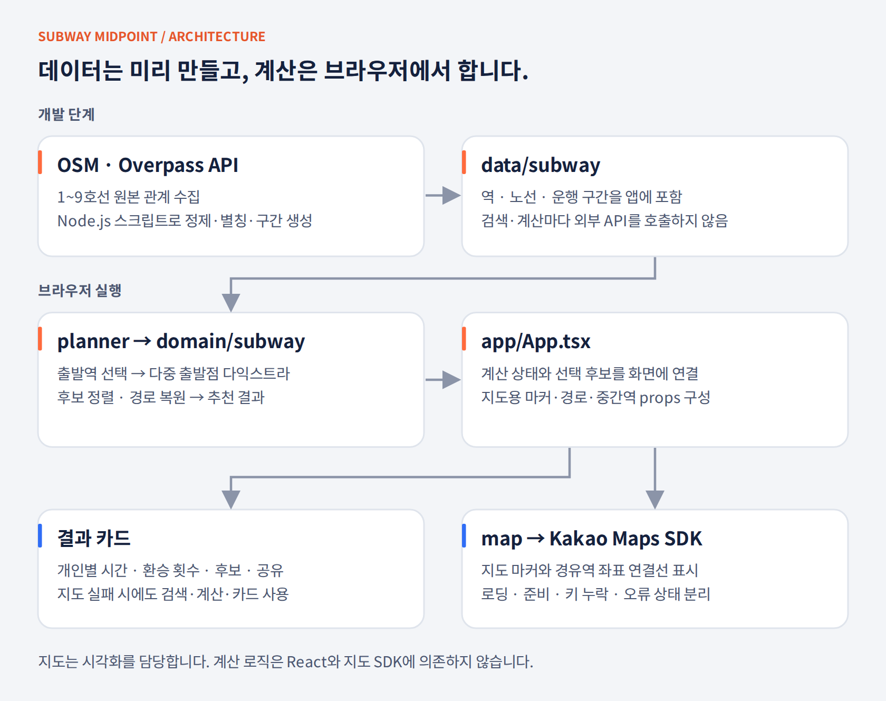
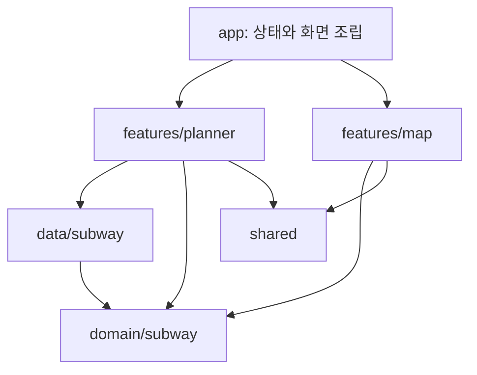

# 프로젝트 설명 · 설계 판단과 구조

[저장소 홈](../README.md) · [개발 가이드](DEVELOPMENT.md) · [검증 기록](VALIDATION.md)

**지도상의 가운데가 아니라 가장 오래 이동하는 사람의 예상 시간을 기준으로 만날 역을 추천합니다.** 계산 기준과 구조, 핵심 타입·실행 흐름, 변경 영향 범위와 문제 추적 순서를 정리했습니다. 실행 방법과 규칙 세부는 [개발 가이드](DEVELOPMENT.md), 실행 결과는 [검증 기록](VALIDATION.md)에 있습니다.

## 해결하려는 문제

여러 사람이 만날 장소를 직선거리의 가운데로만 정하면 분기와 환승이 많은 경로를 이용하는 사람에게 이동 부담이 쏠릴 수 있습니다. "모두에게 공평하다"는 표현을 그대로 두지 않고 **최대 예상 이동시간을 최소화한다**는 계산 기준으로 정했습니다. 동점 처리와 후보 제외 규칙은 [README의 추천 기준](../README.md#추천-기준)에 정리했습니다.

## 코드를 읽는 순서

| 검토할 영역 | 먼저 읽을 파일 | 이어서 볼 파일 |
| --- | --- | --- |
| 문제를 계산으로 구현 | [midpoint.ts](../src/domain/subway/midpoint.ts) | [midpoint.test.ts](../src/domain/subway/midpoint.test.ts) |
| 그래프·최단경로 | [graph.ts](../src/domain/subway/graph.ts) | [dijkstra.ts](../src/domain/subway/dijkstra.ts) |
| 데이터 품질 관리 | [stations.test.ts](../src/data/subway/stations.test.ts) | [fetch-stations.mjs](../scripts/fetch-stations.mjs) |
| 화면 상태 설계 | [plannerReducer.ts](../src/features/planner/model/plannerReducer.ts) | [urlState.ts](../src/features/planner/model/urlState.ts) · [usePlanner.ts](../src/features/planner/model/usePlanner.ts) |
| 입력·접근성 | [DepartureField.tsx](../src/features/planner/ui/DepartureField.tsx) | [planner.spec.ts](../e2e/planner.spec.ts) |
| 표시·공유 | [ResultCard.tsx](../src/features/planner/ui/ResultCard.tsx) | 후보 전환, 시간 표시, 공유 동작 |
| 외부 연동 실패 대응 | [kakaoLoader.ts](../src/features/map/api/kakaoLoader.ts) | [KakaoMap.tsx](../src/features/map/ui/KakaoMap.tsx) |

## 변경 이력과 설계 판단

| 시기 | 변경 | 문제 | 선택 | 근거 |
| --- | --- | --- | --- | --- |
| 2026-02 | [초기 React 앱과 Kakao 지도 연동](https://github.com/MinsangKwak/subway-midpoint/commit/bd44c9e) | 지도 SDK 로딩과 React 렌더링 순서가 꼬이면 마커가 사라짐 | 로더를 분리하고 지도 상태를 계산 상태와 나눔 | [kakaoLoader](../src/features/map/api/kakaoLoader.ts) |
| 2026-09 | [앱 구조·디자인·도구·배포 재구축](https://github.com/MinsangKwak/subway-midpoint/commit/ccc30ce) | 계산이 UI와 섞여 지도 없이 테스트할 수 없음 | 계산을 `domain`으로 분리하고 ESLint import 경계 도입 | [eslint.config.js](../eslint.config.js) |
| 2026-09 | [OSM 기반 1~9호선 데이터 생성](https://github.com/MinsangKwak/subway-midpoint/commit/e9a5985) | 역 배열의 이웃을 연결하던 방식이 1호선 분기에서 실제 인접하지 않은 역을 이음 | 역 노드와 운행 구간 `LINE_SEGMENTS`를 나누고 구간 안의 이웃만 연결. 환승역은 노선별 노드를 유지하고 별도 간선으로 연결 | [graph.ts](../src/domain/subway/graph.ts) · [구로 경유 회귀 테스트](../src/domain/subway/midpoint.test.ts) |
| 2026-10 | [환승 별칭 역 표시 오류 수정과 상위 후보만 경로 복원](https://github.com/MinsangKwak/subway-midpoint/commit/538fe98) | 총신대입구(4호선)·이수(7호선)는 `transferName`으로 묶인 한 역인데 후보 이름을 첫 노드 `name`에서 가져와 "총신대입구 4호선"으로 보이고 7호선 배지가 빠짐. 후보 404개 전부의 경로·좌표를 만든 뒤 정렬 | 표시 이름·노선 목록을 역 키 기준으로 계산해 검색 목록과 결과 카드가 같은 이름을 씀. 정렬에는 최대 시간·합계만 필요하므로 경로 복원을 상위 후보로 제한 | [표시 이름 회귀 테스트](../src/domain/subway/graph.test.ts) · [로컬 측정 기록](VALIDATION.md#성능-측정). 전후 데이터 범위가 달라 통제된 성능 비교는 아님 |
| 2026-10 | [신분당·경의중앙·수인분당·공항철도 추가](https://github.com/MinsangKwak/subway-midpoint/commit/9c5fd54) | 2호선 신촌과 경의중앙선 신촌, 5호선 양평과 경의중앙선 양평이 같은 이름으로 환승역으로 묶임 | 생성 스크립트에 노선별 키 분리 표와 "같은 키의 노드가 800m 이상 떨어지면 경고" 검사, 데이터 테스트에서 같은 조건 확인 | [stations.test.ts](../src/data/subway/stations.test.ts) |
| 2026-10 | [URL 상태 복원과 공유 주소](https://github.com/MinsangKwak/subway-midpoint/commit/cd12cc4) · [Playwright 테스트를 CI에 추가](https://github.com/MinsangKwak/subway-midpoint/commit/5af4a34) | 공유 버튼이 텍스트만 전달하면 받는 사람이 역을 다시 입력. 브라우저 흐름을 수동으로 확인 | 결과가 있을 때 `?from=역,역&pick=후보`를 `history.replaceState`로 반영하고, 그 주소로 열면 계산된 상태로 시작. 결과가 무효화되면 쿼리도 지움. 모르는 역·중복·7곳 이상은 파싱에서 버림 | [urlState](../src/features/planner/model/urlState.ts) · [e2e](../e2e/) |

## 구조

**추천 계산은 UI와 지도 SDK 없이 실행할 수 있고, App이 결과를 화면에 연결합니다.** 역 데이터는 개발 단계에서 생성해 앱에 포함했습니다. 검색하거나 계산할 때마다 외부 데이터 API를 호출하지 않습니다.

### 실행 시점

| 시점 | 처리 | 외부 서비스 의존 |
|---|---|---|
| 개발자가 데이터 갱신 | OSM 관계 수집·정제 → TypeScript 데이터 생성 | Overpass API |
| 앱 모듈 로드 | 정적 데이터로 그래프와 검색 카탈로그 구성 | 없음 |
| 앱 첫 로드 | 주소 쿼리(`?from=`)가 있으면 출발역 복원과 계산을 초기 상태에서 수행 | 없음 |
| 출발역 검색·계산 | 카탈로그 검색 → 출발지별 다익스트라 → 후보 정렬 → 상위 후보만 경로 복원 | 없음 |
| 결과 시각화 | App이 마커·경로·중간역을 지도 props로 변환 | Kakao Maps SDK |

### 의존 관계

- `domain`은 React·UI·생성 데이터에 의존하지 않습니다. 실제 데이터로 확인하는 테스트는 별도입니다.
- `data`는 도메인 타입과 그래프·카탈로그 함수를 사용합니다.
- planner와 map은 서로 직접 호출하지 않고, `App.tsx`에서 두 기능을 연결합니다.
- `shared`는 앱·기능·지하철 데이터에 의존하지 않습니다.

경계는 [ESLint 규칙](../eslint.config.js)의 `no-restricted-imports`로 검사하며 어기면 lint가 실패합니다. 폴더별로 설정을 나누지 않고 앱 전체에 동일한 TypeScript·ESLint 설정을 적용합니다. 노선 배지는 노선 데이터에 의존하므로 `shared`가 아닌 planner에 둡니다.

### 폴더와 설정 파일

| 경로 | 담고 있는 내용 | 시작 파일 |
|---|---|---|
| [src/domain/subway](../src/domain/subway/) | 그래프·최단경로·추천·역 검색의 순수 로직 | [midpoint.ts](../src/domain/subway/midpoint.ts) |
| [src/data/subway](../src/data/subway/) | 생성된 역·구간, 노선 정보, 그래프·검색 카탈로그 초기화 | [index.ts](../src/data/subway/index.ts) |
| [src/features/planner/model](../src/features/planner/model/) | 출발지 상태 전이와 계산 호출 | [usePlanner.ts](../src/features/planner/model/usePlanner.ts) |
| [src/features/planner/ui](../src/features/planner/ui/) | 검색 입력·결과 카드·노선 배지 | [PlannerPanel.tsx](../src/features/planner/ui/PlannerPanel.tsx) |
| [src/features/map/api](../src/features/map/api/) | SDK 로더와 Kakao 타입 | [kakaoLoader.ts](../src/features/map/api/kakaoLoader.ts) |
| [src/features/map/ui](../src/features/map/ui/) | 지도 상태·마커·경로 표시 | [KakaoMap.tsx](../src/features/map/ui/KakaoMap.tsx) |
| [src/shared](../src/shared/) | 특정 기능에 의존하지 않는 버튼·아이콘·표시 함수 | [format.ts](../src/shared/lib/format.ts) |
| [src/app](../src/app/) | planner와 map 조립, 전역 레이아웃·토큰 | [App.tsx](../src/app/App.tsx) |
| [e2e](../e2e/) | Playwright 브라우저 테스트와 공용 조작 함수 | [planner.spec.ts](../e2e/planner.spec.ts) |
| [public](../public/) | 빌드에 그대로 복사되는 정적 파일 (링크 미리보기 이미지) | [og.png](../public/og.png) |
| [scripts](../scripts/) | 데이터 생성과 Markdown 검사 | [fetch-stations.mjs](../scripts/fetch-stations.mjs) |
| [docs](./) · [docs/diagrams](diagrams/) · [docs/images](images/) | 설계·개발·검증 문서, 수정 가능한 SVG와 README용 PNG·실행 캡처 | 이 문서 |
| [.github](../.github/) | CI·배포와 이슈·PR 템플릿 | [ci.yml](../.github/workflows/ci.yml) |

| 설정 파일 | 책임 |
|---|---|
| [package.json](../package.json) · [package-lock.json](../package-lock.json) | 실행·검증 명령과 설치 버전 재현 |
| [.nvmrc](../.nvmrc) | Node.js 22 기준 |
| [tsconfig.json](../tsconfig.json) | TypeScript 검사와 경로 별칭 |
| [vite.config.ts](../vite.config.ts) | React SWC, `@` 별칭, 모드별 base와 `og` 절대 주소, Node 테스트 환경 |
| [playwright.config.ts](../playwright.config.ts) | 데스크톱·모바일 프로젝트, 지도 키 없는 빌드를 preview 서버로 실행 |
| [eslint.config.js](../eslint.config.js) | 미사용 변수·Hooks·기능 간 import 경계 검사 |
| [.editorconfig](../.editorconfig) · [.prettierrc](../.prettierrc) · [.vscode/settings.json](../.vscode/settings.json) | 들여쓰기·줄바꿈·문서 포맷, 저장소에 공유한 편집기 설정 |
| [.env.example](../.env.example) · [.gitignore](../.gitignore) | 지도 키·사이트 주소 환경변수 이름, 의존성·빌드·환경변수·원본 캐시 제외 |
| [.github/workflows/ci.yml](../.github/workflows/ci.yml) · [deploy.yml](../.github/workflows/deploy.yml) | `check`·`e2e` job, main·dev를 각각 빌드해 하나의 Pages 사이트로 배포 |
| [LICENSE](../LICENSE) | 코드 이용 조건 (MIT) |

### 상태와 오류의 경계

[plannerReducer](../src/features/planner/model/plannerReducer.ts)는 출발지·결과·선택 후보·오류 메시지를 함께 관리합니다. 조건이 바뀐 뒤 이전 결과가 남지 않도록 입력 액션은 `invalidate`를 거치고, 후보 전환은 계산 결과를 유지합니다.

| 조작 | 상태 변화 |
|---|---|
| 출발지 추가·삭제·검색어 변경·선택·지우기 | 출발지 갱신, 결과·오류·선택 후보 초기화 |
| 계산 성공 | 결과 저장, 첫 후보 선택 |
| 공통 추천 후보 없음 | 결과 제거, 오류 메시지 저장 |
| 후보 전환 | 결과를 유지하고 선택 인덱스 변경 |

[urlState](../src/features/planner/model/urlState.ts)는 주소 쿼리와 출발역·후보 사이를 변환하는 순수 함수입니다. `from`에는 표시 이름이 아닌 역 키를 저장해 `신촌`과 `신촌(경의중앙)`을 구분하고, `pick`은 0부터 시작하는 후보 인덱스입니다. 알 수 없는 역·중복·최대 입력 수를 넘은 역은 파싱에서 제외합니다.

브라우저 주소 읽기·쓰기는 [usePlanner](../src/features/planner/model/usePlanner.ts)가 담당합니다. 첫 로드에 유효한 출발역이 2곳 이상이면 계산하고, 요청한 후보 인덱스가 없으면 첫 후보를 선택합니다. 결과가 있는 동안 `history.replaceState`로 조건과 선택 후보를 반영하고, 결과가 사라지면 쿼리도 지웁니다.

[KakaoMap](../src/features/map/ui/KakaoMap.tsx)은 로딩·준비·키 누락·SDK 오류 상태를 관리합니다. 계산 상태와 지도 상태를 분리했으므로 지도 키가 없어도 결과 카드를 확인할 수 있습니다. [SDK 로더](../src/features/map/api/kakaoLoader.ts)는 공유 Promise로 중복 로딩 요청을 모읍니다.

검색 입력·공유의 키보드 동작은 [개발 가이드](DEVELOPMENT.md#react-상태와-검색)에 정리했습니다. 지도 커스텀 오버레이에 들어가는 이름은 HTML 이스케이프 후 삽입합니다. 위치 권한은 사용자가 현재 위치 버튼을 눌렀을 때 요청합니다. 이 기능이 추천용 출발역 선택을 대신하지는 않습니다.

## 도메인 지도

노선별 노드 `RawStation`과 사용자가 선택하는 역 `Station`을 구분했습니다. 계산에는 노선별 `nodeIds`를 넘겨 환승 비용을 반영하고, 검색·URL 복원에는 역 단위 `key`를 사용합니다. 계산 결과의 `Leg`는 개인별 시간·환승 표시와 지도 경로에 함께 전달됩니다.

| 타입 (파일) | 뜻 | 핵심 필드 | 쓰는 곳 |
| --- | --- | --- | --- |
| `RawStation` ([types.ts](../src/domain/subway/types.ts)) | 노선별 노드. 환승역은 노선마다 하나씩 | `id`, `name`, `lineId`, `latitude`·`longitude`, `transferName`(다른 이름의 환승역 묶기, 동명이역 분리), `aliases`(검색 전용) | 생성 데이터 `RAW_STATIONS` |
| `LineSegment` ([types.ts](../src/domain/subway/types.ts)) | 한 노선의 운행 구간. 배열 순서가 운행 순서 | `lineId`, `stationIds`, `loop`(2호선 순환) | 생성 데이터 `LINE_SEGMENTS` |
| `SubwayLine` ([types.ts](../src/domain/subway/types.ts)) | 노선 표시 정보 | `id`, `name`, `color`, `badge` | [lines.ts](../src/data/subway/lines.ts), 배지 |
| `GraphEdge` ([graph.ts](../src/domain/subway/graph.ts)) | 가중 간선 | `to`, `minutes`, `kind: 'LINE' \| 'TRANSFER'` | 다익스트라, 환승 횟수 |
| `SubwayGraph` ([graph.ts](../src/domain/subway/graph.ts)) | 계산용 그래프 | `nodes`(id → `RawStation`), `adj`(id → `GraphEdge[]`), `nodesByName`(역 키 → 노드 id 목록) | `dijkstra`, `calculateMidpoint` |
| `Station` ([types.ts](../src/domain/subway/types.ts)) | 사용자가 고르는 "역". 같은 키의 노드 묶음 | `key`(URL `from` 값이자 `nodesByName` 키), `name`(가장 짧은 이름), `lineIds`, `nodeIds`(출발지 묶음으로 그대로 전달) | 검색 카탈로그, reducer, URL |
| `StationCatalog` ([catalog.ts](../src/domain/subway/catalog.ts)) | 검색·복원용 역 목록 | `stations`(이름순), `byKey` | `searchStations`, `parsePlannerQuery` |
| `DijkstraResult` ([dijkstra.ts](../src/domain/subway/dijkstra.ts)) | 출발지 하나의 탐색 결과 | `dist`(도달 불가는 `Infinity`), `prev` | 점수 계산, 경로 복원 |
| `MidpointCandidate` ([midpoint.ts](../src/domain/subway/midpoint.ts)) | 추천 후보 역 | `stationKey`, `name`, `lineIds`, `maxMinutes`(정렬 1순위), `totalMinutes`(2순위), `legs` | 결과 카드, 지도 경로 |
| `Leg` ([midpoint.ts](../src/domain/subway/midpoint.ts)) | 출발지 하나 → 후보의 경로 | `index`(출발지 순서), `fromId`·`toId`, `minutes`, `transfers`, `nodeIds`, `points` | 개인별 시간·환승 표시, 지도 선 |
| `MidpointResult` ([midpoint.ts](../src/domain/subway/midpoint.ts)) | 계산 결과 | `best`(= `candidates[0]`), `candidates`(점수순 상위 `topN`) | reducer `result` |
| `PlannerState` ([plannerReducer.ts](../src/features/planner/model/plannerReducer.ts)) | 화면 상태 | `departures`(2~6칸), `result`, `selectedCandidate`, `error` | `usePlanner`, 패널·카드 |

노선·역·간선 수와 집계 조건은 [검증 기록의 데이터 표](VALIDATION.md#데이터-재생성-확인)에 모았습니다.

## 핵심 프로세스

1번은 데이터 갱신 시, 2번은 앱 모듈 로드 시 실행합니다. 3~8번은 출발역 입력 또는 URL 복원에서 계산·결과 반영으로 이어지는 흐름입니다.

1. **데이터 생성(개발 시점)**: [fetch-stations.mjs](../scripts/fetch-stations.mjs)가 OSM 관계를 정제해 `RAW_STATIONS`·`LINE_SEGMENTS`를 생성합니다. 급행 제외, 괄호 부기 제거, `transferName` 지정, 동명이역 분리를 수행합니다.
2. **그래프·카탈로그 구성(모듈 로드)**: [data/subway/index.ts](../src/data/subway/index.ts)가 `buildSubwayGraph`와 `buildStationCatalog`를 한 번 호출합니다. 중복 ID·없는 역 참조·다른 노선이 섞인 구간을 발견하면 오류를 발생시킵니다.
3. **입력**: [DepartureField](../src/features/planner/ui/DepartureField.tsx)가 `searchStations`로 후보를 표시하고, 선택한 `Station`을 reducer의 `select`로 전달합니다. 입력이 바뀌면 `invalidate`가 결과를 초기화합니다. 공유 주소로 열면 [parsePlannerQuery](../src/features/planner/model/urlState.ts)가 `byKey`로 역을 복원합니다.
4. **그래프 조회**: [usePlanner](../src/features/planner/model/usePlanner.ts)가 각 출발역의 `Station.nodeIds`를 `calculateMidpoint`에 전달합니다. 함수는 `stationKey`로 중복 역을 제거하고, 서로 다른 출발역이 2곳 미만이면 `null`을 반환합니다.
5. **계산**: 출발지마다 `dijkstra(graph, nodeIds)`를 한 번씩 실행합니다(최대 6회). 환승역에서 출발하면 모든 노선 노드를 비용 0인 출발점으로 둡니다.
6. **점수·정렬**: `nodesByName`의 역마다 출발지별 최소 `dist`를 모아 `maxMinutes`·`totalMinutes`를 구합니다. 출발역과 한 곳에서라도 도달할 수 없는 역은 제외하고 `max → total → 이름순`으로 정렬합니다.
7. **상위 경로 복원**: 상위 `topN`(기본 3) 후보에만 `restorePath`를 적용하고 환승 횟수·좌표를 추가합니다. 복원한 경로가 비어 있으면 `PathRestoreError`를 발생시킵니다.
8. **상태·URL 반영**: reducer의 `computed`가 결과를 저장하고 첫 후보를 선택합니다. `usePlanner`의 effect는 `buildPlannerQuery`로 만든 `?from=키,키&pick=n`을 `history.replaceState`로 주소에 반영합니다. [App](../src/app/App.tsx)은 선택 후보의 `legs`를 지도 마커·경로 props로 변환합니다.

## 왜 다익스트라와 이진 힙인가

| 선택지 | 쓰지 않은 이유 |
| --- | --- |
| BFS | 역 간 거리와 환승 여부에 따라 간선 가중치가 다릅니다. 간선 수가 가장 적은 경로가 최단 시간 경로와 일치하지 않습니다. |
| 배열 선형 탐색 다익스트라 | 노드 606개·간선 1,424개에서 매 단계 최소값을 선형 탐색하면 O(V²)입니다. 이진 힙을 사용하면 시간 복잡도가 O((V+E) log V)로 줄어듭니다. |
| 플로이드–워셜(전체 쌍) | 한 번의 계산에 필요한 출발지는 최대 6곳입니다. 모든 역 쌍을 미리 계산하는 대신 선택한 출발지에서만 탐색합니다. |
| 그래프 라이브러리 | 환승역의 노드 묶음을 출발점으로 받는 [탐색 함수](../src/domain/subway/dijkstra.ts)를 직접 구현했습니다. 역 단위 도착 판정과 출발역 제외는 `calculateMidpoint`가 담당하며, 탐색과 후보 계산을 나눠 테스트합니다. |

최소 힙은 `push`할 때 부모와 비교하며 항목을 올리고, `pop`할 때 자식 중 비용이 작은 항목과 바꾸며 내립니다. 같은 노드가 여러 번 들어갈 수 있으므로 꺼낸 항목이 `cost > dist[id]`이면 건너뜁니다. [dijkstra.test](../src/domain/subway/dijkstra.test.ts)에서 더 짧은 우회 경로를 선택하는지, 도달 불가능한 노드에 `Infinity`를 반환하는지 확인합니다.

## 설계 트레이드오프

| 결정 | 선택 | 대안 | 선택 이유와 비용 |
| --- | --- | --- | --- |
| 상태 관리 | `useReducer` + 훅 하나 | Redux·Zustand 등 스토어 | 한 화면의 `departures`·`result`·`selectedCandidate`·`error`를 관리합니다. 입력 변경과 결과 무효화 규칙은 reducer의 순수 함수로 테스트합니다. 여러 화면에서 상태를 공유해야 할 때 별도 스토어를 검토합니다. |
| 계산 위치 | 브라우저 | 서버 API | 정적 데이터를 앱에 포함하고 최대 6곳의 출발지를 브라우저에서 계산합니다. 데이터만큼 번들 크기가 늘고 갱신 시 재배포가 필요합니다. 실시간 시각표를 도입하면 데이터 조회와 계산 위치를 다시 검토해야 합니다. |
| 스타일 | CSS Modules + 토큰 CSS | Tailwind·CSS-in-JS | 컴포넌트별 클래스 범위를 분리하고 공통 색·간격을 [tokens.css](../src/app/styles/tokens.css)에서 관리합니다. 유틸리티 클래스 방식과 비교하면 컴포넌트별 스타일 파일을 별도로 관리해야 합니다. |
| 소요시간 | 거리·환승 비용 기반 추정 | 실제 시각표·실시간 API | 계산에 외부 API를 호출하지 않고 같은 입력으로 결과를 재현할 수 있습니다. [시간 가중치](DEVELOPMENT.md#그래프와-시간-가중치)는 고정값이며 실제 운행시간과의 차이는 [현재 한계](../README.md#현재-한계)에 설명했습니다. |
| 경로 복원 범위 | 상위 `topN`만 | 모든 후보 | 정렬에 필요한 시간 점수를 먼저 비교하고 상위 후보의 경로만 복원합니다. 전체 후보의 경로·좌표 생성을 줄이는 대신, 더 많은 후보를 표시하려면 `topN`을 늘려야 합니다. |
| 역 단위 | 이름 기반 `stationKey` | OSM 노드 id | 노선별 노드를 사용자에게 하나의 역으로 표시하려면 묶음 키가 필요합니다. 동명이역(신촌·양평)은 `transferName`으로 직접 분리하며, 잘못 묶인 역은 800m 거리 검사와 데이터 테스트로 확인합니다. |
| 기능 간 결합 | `App`에서 조립, ESLint import 경계 | 기능끼리 직접 import | planner와 map의 직접 의존을 제한해 지도 SDK 없이 계산과 상태를 테스트합니다. 두 기능을 연결하는 `markers`·`routes` 변환은 `App.tsx`가 맡습니다. |

## 변경 영향 범위

규칙을 변경할 때 수정 위치와 함께 확인할 테스트·문서를 살펴봅니다.

| 변경 | 수정 위치 | 함께 확인할 테스트·문서 | 바뀌지 않는 곳 |
| --- | --- | --- | --- |
| 노선 추가 | [fetch-stations.mjs](../scripts/fetch-stations.mjs)의 노선 목록·키 분리 표 → `npm run data:stations` → [lines.ts](../src/data/subway/lines.ts)에 id·색·배지 | [stations.test.ts](../src/data/subway/stations.test.ts)의 종점·환승 묶음·새 노선 연결 항목, README의 노선 수와 역 수, [검증 기록](VALIDATION.md) 데이터 표 | `domain/*`, reducer, URL 규칙, 지도 |
| 환승 비용 변경 | [graph.ts](../src/domain/subway/graph.ts)의 `TRANSFER_MINUTES` 한 곳 | [graph.test](../src/domain/subway/graph.test.ts)·[midpoint.test](../src/domain/subway/midpoint.test.ts)의 환승 비용 검증, 실제 데이터의 기대 역, [시간 가중치 표](DEVELOPMENT.md#그래프와-시간-가중치) | 다익스트라, 정렬, 화면 |
| 공용 승강장 환승 비용 0 | `buildSubwayGraph`의 환승 간선 생성부에 노선 쌍별 예외 | 새 그래프 테스트, [시간 가중치 표](DEVELOPMENT.md#그래프와-시간-가중치), `countTransfers`가 노선 변경을 여전히 환승으로 셀지 결정 | 카탈로그, URL |
| 정렬 규칙 변경(예: 합계 우선) | [midpoint.ts](../src/domain/subway/midpoint.ts)의 `scored.sort` 비교 함수 | `calculateMidpoint (ranking rule)` 테스트의 기대 순서, README "추천 기준", e2e의 기대 역명이 있으면 함께 | 그래프, 다익스트라, URL |
| 출발지 최대 수 변경 | [plannerReducer.ts](../src/features/planner/model/plannerReducer.ts)의 `MAX_DEPARTURES`(색이 반복되지 않게 하려면 `DEPARTURE_COLORS`도) | reducer·urlState 테스트, 패널 레이아웃 확인 | 도메인 전체 |
| URL 파라미터 이름 변경 | [urlState.ts](../src/features/planner/model/urlState.ts)의 `FROM_PARAM`·`PICK_PARAM` | urlState 테스트, e2e의 주소 단언, README 공유 예시. 기존 공유 주소와의 호환 처리 확인 | 도메인, 지도 |
| 지도 SDK 교체 | [features/map](../src/features/map/) 전체 | e2e는 키 없는 빌드이므로 새 SDK의 실제 렌더링은 별도 확인. [지도 설정](DEVELOPMENT.md#지도-설정) | planner, domain (`App`의 props 변환만 조정) |

## 문제 추적 순서

입력과 데이터부터 계산·화면 순서로 확인하면 문제 범위를 좁힐 수 있습니다. 지도 키·배포·CI 문제는 [개발 가이드의 문제 확인](DEVELOPMENT.md#문제-확인)을 따릅니다.

1. **입력이 의도한 역인가**: 주소의 `from` 값을 `stationCatalog.byKey[키]`로 조회합니다. `신촌`(2호선)과 `신촌(경의중앙)`은 다른 역입니다. 복원된 출발역 수가 예상과 다르면 파싱 과정에서 중복·알 수 없는 역이 제외됐는지 확인합니다.
2. **데이터가 맞는가**: `npm test`로 [stations.test.ts](../src/data/subway/stations.test.ts)의 노드·구간·환승 묶음 검사를 실행합니다. 통과한 뒤에도 특정 구간이 의심되면 `subwayGraph.adj['l1_구로']`처럼 인접 목록을 직접 확인합니다.
3. **그래프 간선이 맞는가**: 두 역 사이 `GraphEdge.minutes`가 거리와 시간 가중치 규칙에 맞는지, 환승 간선이 다른 노선 사이에만 생성됐는지 확인합니다. 분기 구간에서는 실제로 인접하지 않은 역이 연결됐는지도 살펴봅니다.
4. **단일 출발 거리가 맞는가**: `dijkstra(subwayGraph, station.nodeIds).dist[목표노드]`를 출발지별로 확인합니다. `Infinity`이면 출발 노드와 목표 노드가 올바른지, 두 지점 사이에 도달 가능한 경로가 있는지 확인합니다.
5. **점수와 정렬이 맞는가**: `calculateMidpoint(..., { topN: 20 })`으로 조회 범위를 넓혀 `maxMinutes`·`totalMinutes`를 비교합니다. 기대 역이 없으면 출발역 제외 조건, 출발지별 도달 가능 여부, 정렬 순위와 `topN`을 확인합니다.
6. **경로 복원이 맞는가**: `legs[i].nodeIds`의 첫 노드가 출발 `nodeIds`에 포함되고 마지막 노드가 `toId`인지 확인합니다. `PathRestoreError`가 발생하면 목표 노드의 `dist`, `prev` 연결, 경로 복원 로직과 관련 변경 이력을 함께 살펴봅니다.
7. **화면 상태가 맞는가**: reducer의 `result`·`selectedCandidate`와 주소의 `pick`을 비교합니다. 입력을 바꾼 뒤에도 이전 결과가 남으면 해당 액션이 `invalidate`를 거치는지 확인합니다.
8. **지도만 다른가**: 카드 결과와 지도 선이 다르면 `App.tsx`의 `routes` 변환과 [KakaoMap](../src/features/map/ui/KakaoMap.tsx)에 전달된 경로를 확인합니다. 지도는 계산 결과를 받아 표시합니다.

## 화면과 디자인 방향

지하철 안내 사인의 잉크 네이비와 시그널 오렌지를 기본으로 삼았습니다. 출발지의 점·선과 결과 역명판으로 입력과 결과를 구분하고, 노선 배지에는 실제 노선별 색을 사용합니다.

데스크톱은 지도 위 패널, 모바일은 접고 펼치는 하단 패널을 사용합니다. 공통 스타일의 관리 방식은 [설계 트레이드오프](#설계-트레이드오프)의 스타일 항목에 있습니다.

## 다음 단계

다음 단계는 경춘선·서해선·경전철 등 노선 확대, 공용 승강장 구간의 환승 비용 조정, 실제 시간 데이터 반영입니다. 수정 위치와 확인 항목은 [변경 영향 범위](#변경-영향-범위)에 정리했습니다.
